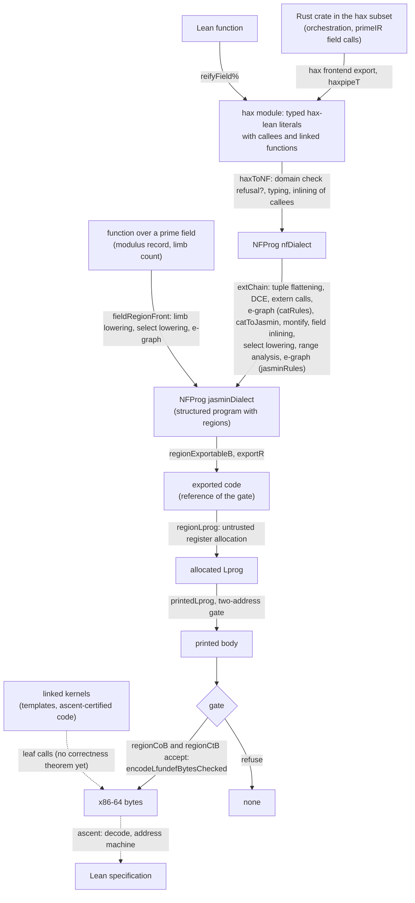

# The compiler pipeline

The hax compiler `haxc` has one entry, `compileA`, and one compile line:

```
compileA = haxToNF → extChain → compileRegion
```

`compileA` takes a module (an entry function with the functions it may call and the
linked functions it calls) and an ABI layout, and returns a printed x86-64 program with
its bytes, or `none` when a stage declines or a check refuses. Its value theorem is
`haxc_correct_auto` and its constant-time theorem `haxc_ct_proved_all`
(`Haxc.ComposeV1`, `Haxc.ComposeCTStraight`). A name given with its module is in the
development repository; a linked name is in this package.



| Stage | Definition | Check | Theorem |
|---|---|---|---|
| Rust to a typed literal | hax frontend export read by `haxpipeT` (hax-lean) | the hax subset | the hax-lean semantics `evalImp` is the source semantics |
| Lean function to a literal | `reifyField%` | elaboration | `jacAdd_bytes`, `jacDbl_bytes` (`Haxc.LeanFrontEc`) |
| Front | `haxToNF` (`Haxc.NFChain`) | `HaxModule.refusal?`, decided | `NFEntry.compileR_correct` at `haxEntry` |
| Chain to the Jasmin dialect | `extChain` (`Haxc.NFChainCall`), a run of a certified pass chain | per-step side conditions, decided | `extChainCert`, `extChain_denote`; [`PassChain.Cert.sound`](CatCrypt/Crypto/SecureCompilation/VIR/PassChain.lean) |
| Field front | `fieldRegionFront` (`Haxc.FieldLowerChain`), a function over the field lowered to limbs | the front equation is a hypothesis | `fieldRegionFront_denote`, `fieldChain_correct_auto` |
| Export | `exportR` (`Haxc.RegionBackend`) | `regionExportableB`, decided | `compileRegion_correct` |
| Register allocation and printing | `regionLprog`, `printedLprog` | `regionCoB`, whose image conjunct is the translation validation [`ownedCheckMC`](CatCrypt/Crypto/SecureCompilation/X86Backend/OwnedLprogTVChecked.lean) of the printed body against the reference | [`ownedCheckMC_sound`](CatCrypt/Crypto/SecureCompilation/X86Backend/OwnedLprogTVChecked.lean), `compileRegion_correct` |
| Leakage | the printed body | `regionCtB`: event check, printed class `printedAddrWB`, image gate `imgGateBW`, decided | `regionChain_bytes_ct` (`Haxc.ComposeCTStraight`) |
| Encoding | `encodeLfundefBytesChecked` | decode round trip, decided | [`decodeLprog_of_decodesToB`](CatCrypt/Crypto/SecureCompilation/X86Backend/DecodeLayout.lean) |
| Bytes to a specification | decoding and the address machine `aMachine` | none | `haxc_correct_auto`; the ascent theorems of [ASCENT.md](ASCENT.md) |

The compiler ranges over the programs it accepts: every theorem above holds for each
result of `compileA`, and a check that fails makes the result `none`. The value and
constant-time theorems are stated for modules without linked functions
(`m.linked = []`); a calling body is gated and compiled with the bytes of its callee
appended. [CORRECTNESS.md](CORRECTNESS.md) gives each check with its class (decided
side condition or translation validation) and the trust ledger;
[HEADLINES.md](HEADLINES.md) states each headline with its hypotheses.

## The dialect tower beside `compileA`

The typed SSA framework `Com`, the dialects `catCryptDialect`, `jasminDialect` and the
PrimeIR dialects, and the instruction selection to x86-64, AArch64 and RV64 are the
levels at which the theorems of the [README](README.md#the-pipeline) are stated. The
front `haxToLowCT`, the Jasmin `.jinc` importer and the relational front reach them;
`compileA` uses `jasminDialect` as the target of `extChain` and does not pass through
`LowCT` or `Com`.
