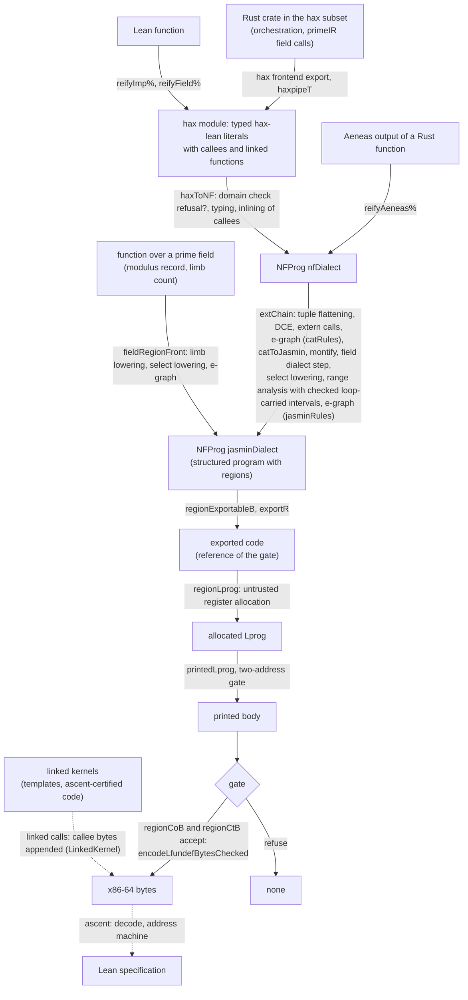

# The compiler pipeline

The hax compiler `haxc` has one entry, `compileA`, and one compile line:

```
compileA = haxToNF → extChain → compileRegion
```

`compileA` ([`Haxc/ComposeV1.lean`](CatCrypt/Crypto/SecureCompilation/Haxc/ComposeV1.lean))
takes a module (an entry function with the functions it may call and the linked
functions it calls) and an ABI layout, and returns a printed x86-64 program with its
bytes, or `none` when a stage declines or a check refuses. Its value theorem is
[`haxc_correct_auto`](CatCrypt/Crypto/SecureCompilation/Haxc/RegionLinkCall.lean), which
holds for every result. Its constant-time theorem
[`haxc_ct_proved_all`](CatCrypt/Crypto/SecureCompilation/Haxc/ComposeCTStraight.lean)
takes as hypotheses constant time of the translation `haxToNF` (`HaxToNFCTLOn`),
termination of the source at one fuel on the admissible entry states (`hterm`) and
public labels that agree with the layout (`PubLabelsOK`).
[`haxc_rc_proved_all`](CatCrypt/Crypto/SecureCompilation/Haxc/RCInstance.lean) states
both together as the gate conclusion, from the Boolean level check `haxToNFCTBL`, and
restates the gate conclusion as robust compilation at distance `0` with a choice
simulator; that conjunct holds for every compiler that satisfies the gate conclusion
with a deterministic target (the gate and the robust-compilation statement are those of
`CatCryptCore.Crypto.RCGate` in CatCrypt-core). The bytes are read by the package's own
decoder `decodeLprog` and run on its own x86-64 model `aMachine`.
The executable `haxc` runs `compileA` on a hax export
([BUILDING.md](BUILDING.md#run-the-hax-compiler)).



| Stage | Definition | Check | Theorem |
|---|---|---|---|
| Rust to a typed literal | hax frontend export read by `haxpipeT` (hax-lean) | the hax subset | the hax-lean semantics `evalImp` is the source semantics |
| Lean function to a literal | [`reifyImp%`](CatCrypt/Hax/ReifyImp.lean), with [`reifyField%`](CatCrypt/Hax/ReifyField.lean) over `ZMod p` | elaboration; the tactic `ascend_reified` | [`leanFront_correct`](CatCrypt/Crypto/SecureCompilation/Haxc/LeanFront.lean) |
| Aeneas output to an NF program | [`reifyAeneas%`](CatCrypt/Crypto/SecureCompilation/AeneasFront/Reify.lean), entry [`aeneasEntry`](CatCrypt/Crypto/SecureCompilation/AeneasFront/Entry.lean) | elaboration, proof by construction | `NFEntry.compileR_correct` at `aeneasEntry`; [`aeneasEntry_compileR_ct`](CatCrypt/Crypto/SecureCompilation/AeneasFront/EntryCT.lean) |
| Front | [`haxToNF`](CatCrypt/Crypto/SecureCompilation/Haxc/NFChain.lean) | [`HaxModule.refusal?`](CatCrypt/Crypto/SecureCompilation/Haxc/NFChain.lean), decided | [`NFEntry.compileR_correct`](CatCrypt/Crypto/SecureCompilation/Haxc/ComposeV1.lean) at `haxEntry` |
| Chain to the Jasmin dialect | [`extChain`](CatCrypt/Crypto/SecureCompilation/Haxc/ExtChain.lean), a run of a certified pass chain | per-step side conditions, decided | [`extChainCert`, `extChain_denote`](CatCrypt/Crypto/SecureCompilation/Haxc/ExtChain.lean); [`PassChain.Cert.sound`](CatCrypt/Crypto/SecureCompilation/VIR/PassChain.lean) |
| Export | [`exportR`](CatCrypt/Crypto/SecureCompilation/VIR/JasminLprogExport/ExportRegions.lean) | [`regionExportableB`](CatCrypt/Crypto/SecureCompilation/VIR/JasminLprogExport/ExportRegionsAbi.lean), decided | [`compileRegion_correct`](CatCrypt/Crypto/SecureCompilation/Haxc/RegionBackend.lean) |
| Register allocation and printing | [`regionLprog`](CatCrypt/Crypto/SecureCompilation/Haxc/RegionBackend.lean), [`printedLprog`](CatCrypt/Crypto/SecureCompilation/Haxc/BackHalfBase.lean) | [`regionCoB`](CatCrypt/Crypto/SecureCompilation/Haxc/RegionBackend.lean), whose image conjunct is the translation validation [`ownedCheckMC`](CatCrypt/Crypto/SecureCompilation/X86Backend/OwnedLprogTVChecked.lean) of the printed body against the reference | [`ownedCheckMC_sound`](CatCrypt/Crypto/SecureCompilation/X86Backend/OwnedLprogTVChecked.lean), `compileRegion_correct` |
| Leakage | the printed body | [`regionCtB`](CatCrypt/Crypto/SecureCompilation/Haxc/RegionBackend.lean): event check, printed class [`printedAddrWB`](CatCrypt/Crypto/SecureCompilation/X86Backend/DecodePrintedAddrW.lean), image gate [`imgGateBW`](CatCrypt/Crypto/SecureCompilation/X86Backend/ImageAddrSimW.lean), decided | [`regionChain_bytes_ct`](CatCrypt/Crypto/SecureCompilation/Haxc/ComposeCTStraight.lean) |
| Encoding | [`encodeLfundefBytesChecked`](CatCrypt/Crypto/SecureCompilation/X86Backend/LprogBytes.lean) | decode round trip, decided | [`decodeLprog_of_decodesToB`](CatCrypt/Crypto/SecureCompilation/X86Backend/DecodeLayout.lean) |
| Bytes to a specification | decoding and the address machine `aMachine` | none | [`haxc_correct_auto`](CatCrypt/Crypto/SecureCompilation/Haxc/RegionLinkCall.lean); the ascent theorems of [ASCENT.md](ASCENT.md) |

The compiler has three fronts, and each proves that the program it produces computes its
source. A Rust function enters through hax: `haxpipeT` reads the export of the hax frontend
as a typed hax-lean module, and `haxToNF` translates it. A Lean function enters through
`reifyImp%`, which reads its body over words, arrays, counted folds and calls as a hax-lean
literal, and `ascend_reified` proves that the literal denotes the function; `reifyField%`
first reads the operations of `ZMod p` as field calls. The output of Aeneas for a Rust
function enters through `reifyAeneas%`, which reads it as an NF program with a proof built
alongside the reading. The first two reach `compileA`; the third enters the same back half
at `aeneasEntry`. A hand-written `Com` or `NFProg` term is not an input.

The compiler ranges over the programs it accepts: every theorem above holds for each
result of `compileA`, under the hypotheses that [HEADLINES.md](HEADLINES.md#the-hax-compiler)
lists (for constant time, constant time of the translation and termination of the
source), and a check that fails makes the result `none`. A module with
linked functions is gated and compiled with the bytes of each callee appended; the
value and constant-time theorems cover it when the linked functions have distinct names
and are linked kernels (`LinkedKernel`), and the value theorem then states the result
both for the run through the call and for the run with the call answered by the
guarded meaning of the callee. [CORRECTNESS.md](CORRECTNESS.md) gives each check with
its class (decided side condition or translation validation);
[HEADLINES.md](HEADLINES.md) states each headline with its hypotheses.

The field front [`fieldRegionFront`](CatCrypt/Crypto/SecureCompilation/Haxc/FieldLowerChain.lean)
is a route beside `compileA` into the structured program of `jasminDialect`: it lowers a
function over a prime field to limbs (`fieldLowerStep`), followed by the select lowering and
the e-graph pass, and `compileRegion` compiles its program
([`fieldRegionFront_denote`, `fieldChain_correct_auto`](CatCrypt/Crypto/SecureCompilation/Haxc/FieldLowerChain.lean)).
`compileA` applies neither `fieldRegionFront` nor the inlining step `fieldInlineStep`
(`NFChainCall`): its front inlines the calls of the functions of the module by
`HaxModule.inline?`, and `extChain` lowers the tagged field calls by `fieldDialectStep`.

## The dialect tower beside `compileA`

The typed SSA framework `Com`, the dialects `catCryptDialect`, `jasminDialect` and the
PrimeIR dialects, and the instruction selection to x86-64, AArch64 and RV64 are the
levels at which the theorems of the [README](README.md#the-pipeline) are stated. The
LowCT front `haxToLowCT` (a deprecated module outside the path of `compileA`), the
Jasmin `.jinc` importer and the relational front reach them. `compileA` uses `jasminDialect` as the target of `extChain` and does not pass
through `LowCT` or `Com`; its import closure contains no module of `haxToLowCT`, and the
call-name tables it shares with that front are in
[`HaxCallNames`](CatCrypt/Crypto/Hax/HaxCallNames.lean).
