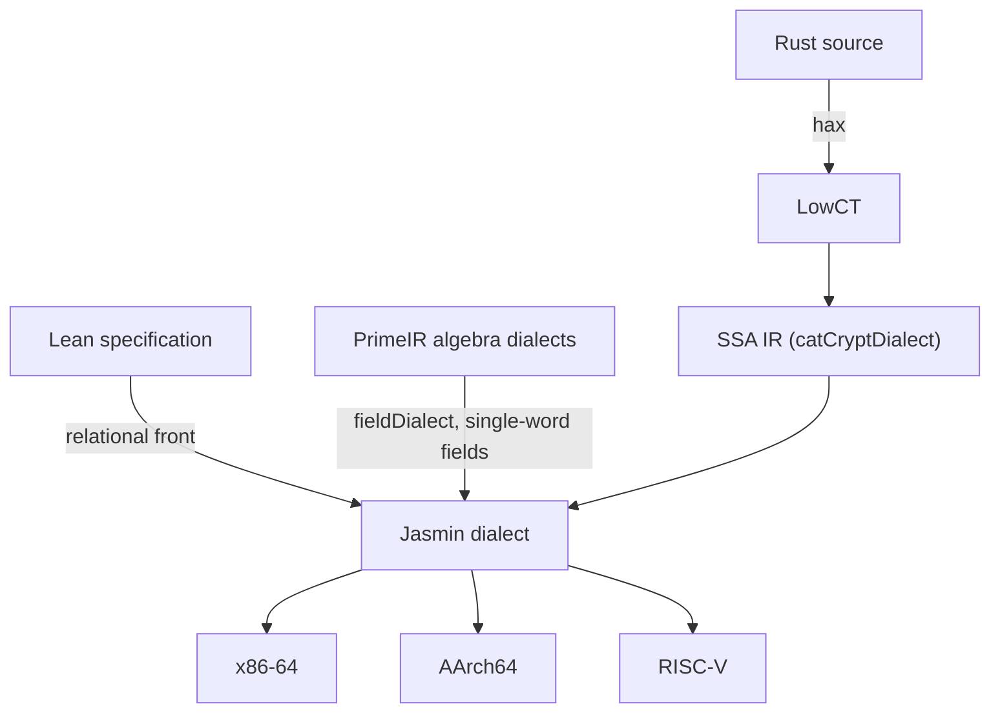

# catcrypt-compiler

A compiler for cryptographic code, written in the Lean 4 proof assistant together
with its correctness proofs. It accepts a program as extracted Rust or as a Lean
specification, lowers it through typed dialects that each carry a Lean denotation,
and emits x86-64, AArch64 and RISC-V code inside Lean. The design draws on
[AUCurves](https://github.com/AU-COBRA/AUCurves), bedrock2, Rupicola and
[Jasmin](https://github.com/jasmin-lang/jasmin) ([PROVENANCE.md](PROVENANCE.md)).

CatCrypt is a research prototype. Its interfaces, the covered source fragment and
the emitted surface change between versions.

## The guarantees

Theorem names are relative to the namespace `CatCrypt.Crypto.SecureCompilation`, and
paths to `CatCrypt/Crypto/SecureCompilation/`, unless they begin with `CatCrypt`.

| Theorem | Level | Fragment |
|---|---|---|
| `VIR.DialectToJasminComCorrect.cryptoDialectToJasminCom_denote_eq'` | SSA IR → Jasmin dialect | every program the lowering accepts |
| `Dialects.TranslateDialectScalar.transU_denote` | LowCT → SSA IR | `IsCoveredSU`: counted loops, conditionals, sequencing and data-dependent `while`, nested to any depth |
| `VIR.CompilerCorrectnessExtracted.rustToJasminCom_endToEnd_unconditional` | LowCT → Jasmin dialect | `IsCoveredSCtl`: straight-line word code, counted loops, conditionals |
| `ScalarLinX86Demo.com_x86_e2e`, `ScalarLinNeutralDemo.com_arm_e2e`, `MultiBackendDemo.com_riscv_e2e` | Jasmin dialect → x86-64, AArch64, RV64 instructions | straight-line `ComOK` programs over 64-bit registers |
| `VIR.JasminLsemMemSourceTieWhileUncond.whileMem_export_faithful_comL_uncond` | emitted loop → linear machine model with memory | data-dependent countdown loops |
| `X86Backend.MachineConstantTime.owned_ct_control_flow` | leakage trace of the model IR `OwnedCF` (no emitted branch is covered) | public guards and literal trip counts |
| `CatCrypt.Crypto.Jasmin.LowCT.cmdCT_sound` | LowCT constant-time analysis | programs `cmdCT` accepts |
| `Ascent.Demos.Ed25519PointAddBytes.paShippedBytes_correct` | x86-64 bytes → Edwards addition | the imported `ed25519_point_add` block |

[HEADLINES.md](HEADLINES.md) states each compiler headline with its hypotheses, and
[NAVIGATION.md](NAVIGATION.md) locates every subsystem and its main theorem.

### Functional correctness

- Dialect lowering. When the lowering from the SSA IR to the Jasmin dialect
  succeeds, the lowered program denotes the transport of the source denotation
  (`cryptoDialectToJasminCom_denote_eq'`). `VIR.LoweringDataComp.compileVia_comp_correct`
  composes two dialect lowerings and states the result for the Jasmin-IR evaluator
  `runProg`, given per-operation transport hypotheses, leaf agreement (`LeafAgrees`)
  and a straight-line lowered program. `Algebraic.FieldToJasminWord.fieldToJasminWord_denote`
  lowers `fieldDialect` programs over a single-word prime field to the Jasmin
  dialect with preserved denotation.
- Rust front. `rustToJasminCom_endToEnd_unconditional` equates the Jasmin value with
  the value that the machine-word semantics `semScalar` leaves in the tracked output,
  and asserts that a post-state related to the LowCT execution relation `RustExec`
  exists. `Dialects.RustExecSemScalarBridge.rustToJasminCom_endToEnd_rustexec_adeq_topLevel`
  equates the Jasmin value with the `RustExec` output word on `IsCoveredAdeq`, for
  inputs in `u64` range. `VIR.RustToJasminComWhile.transU_to_jasminCom_endToEnd`
  extends the statement to data-dependent `while` loops over the fuel-bounded
  semantics `semU`. The translation from hax-lean's AST to LowCT has its own
  simulation theorems (`CatCrypt.Crypto.Hax.haxToLowCT_simulates_program` and
  siblings, [CatCrypt/Crypto/Hax/AGENTS.md](CatCrypt/Crypto/Hax/AGENTS.md)).
- Machine code. For a straight-line `Com` over `ComOK` (64-bit add, sub, mul, and,
  or, xor, widening high multiply, immediate shifts, constants), the block that the
  scalar instruction selection produces, run from registers holding the inputs,
  leaves `Com.denote` in the result register. `ARMBackend.ComToArmLsem.comToArmLsem_correct`
  and `RISCVBackend.ComToRiscvLsem.comToRiscvLsem_correct` restate the result on the
  base arithmetic-logic subset over the `runBBlock` and RV64 machine models.
  `RISCVBackend.ComToRiscvLsem.riscvStep64_sail_grounded` equates each base RV64
  instruction step with an `execute_RTYPE` clause copied from
  [sail-riscv-lean](https://github.com/opencompl/sail-riscv-lean) into
  `RISCVBackend/SailRiscv64Refinement.lean`. The encoders of both backends carry
  decode round trips against decode field splits transcribed from the Sail decode
  clauses.
- Emitted loops. The `VIR.JasminLsemMem*` theorems run the emitted counter loops,
  fill loops, data-dependent loops, loop nests and nested calls in the linear machine
  model and equate the result with the source denotation (`ComL.denote`);
  [HEADLINES.md](HEADLINES.md) lists them.
- Ascent. The ascent proves that a program at one of the compiler's low levels (a
  LowCT command, an x86 or RV64 instruction list, x86 bytes) computes a Lean
  specification ([ASCENT.md](ASCENT.md)). `paShippedBytes_correct` shows that the
  encoded bytes of the imported `ed25519_point_add` block decode to a block that
  computes Edwards addition on inputs below `2^255 − 19`.

### Constant time

- x86-64, straight-line. `X86Backend.AllocCTPreservation.toLprogPhysAbi_gather_constant_time`:
  an exported function body with direct addressing that gathers to an x86 instruction block leaks the same
  machine trace (branch decisions and memory addresses) from any two states.
  `VIR.JasminLsemRobust.owned_lsem_correct_and_robust_straightline` pairs functional
  correctness of the linearizer with a leakage trace that reads no register value; the
  trace equality holds for every program of the fragment and is not constant-time
  evidence.
- x86-64, structured control flow, on a model IR. `owned_ct_control_flow`: a block of
  the model IR `OwnedCF` built from conditionals with public guards and loops with
  literal trip counts leaks the same trace from any two states that agree on the public
  registers. `OwnedCF` is not tied to the emitted `Lcmd` or to bytes, so no emitted
  branch is covered.
- Source. `cmdCT_sound`: a program accepted by the analysis `cmdCT`, run from two
  public-equivalent states, reaches public-equivalent states, under the per-leaf
  assumption `LeafCTAssumption` and the hypothesis `CMOVInvariant` (which holds for a
  select only when its two sources are the same slot; `cmdCT` admits no computation
  on secrets). `cmdCT` accepts a
  data-dependent loop exactly when its guard is public
  (`LowCTVartimeLeak.cmdCT_RWhileNz_iff`); for example, it accepts the
  early-terminating modular inverse of RSA verification under an all-public level
  table and rejects it under a secret guard (`VartimeBignumInverse.vartimeInvert_public_only`).

### Security ties

hax lets one Rust source serve as compiler input and as the model for computational
security proofs in the wider CatCrypt development, following
[The Last Yard](https://eprint.iacr.org/2023/185). The `*SecurityTie` modules equate
a dependency record built from the `Com` denotations of compiled kernels with the
record the security layer reasons over (`CompileFromHaxSecurityTie.toRoundDeps_eq_spec`
for the SHA-256 round functions), and `CompileFromHaxSecurityTie.tie_transfer`
carries any property of that record to the compiled kernels at the `Com` denotation.

## Scope

The theorems above cover the fragments in their rows. Outside them:

- the hax export from Rust (`cargo hax`) and hax-lean's JSON adapter;
- constant time on AArch64 and RISC-V, and for data-dependent loops in emitted code;
- the assembly text printers and the external assembler;
- whole-function register allocation of the x86 exporter `Com.toLprogPhysAbi`;
- the value of an opaque leaf call, which a kernel theorem takes as a supplied leaf
  semantics (`LeafAgrees`, `jasminDenoteWith`);
- the Jasmin text printed for `jasminc`, and the MLIR text path (`emitFunc`), whose
  toolchain correctness is the proposition `MLIRBackend.MlirBackendSemanticsAgrees`;
- a Sail model of AArch64 execution;
- the quantum dialect (`VIR/QuantumDialect.lean`), which defines ops and types;
- computational security bounds, which the wider CatCrypt development proves.

A theorem depends on an axiom only if `#print axioms` lists it;
[BUILDING.md](BUILDING.md#check-axioms) gives the procedure. The package's `axiom`
declarations are listed by

```bash
git grep -nE '^(/--.*-/ *)?axiom [A-Za-z_][^ ]* *(:|\(|\{|\[|$)' -- 'CatCrypt/*.lean'
```

## Architecture

A cryptographic implementation has three parts: orchestration (protocol and control
flow), algebra (field, curve and polynomial arithmetic) and leaves (low-level
primitives). Each enters at its own level.



- LowCT is the low-level constant-time command language
  (`CatCrypt/Crypto/Jasmin/LowCT.lean`), ported from AUCurves. hax-lean's AST
  translates to it, and Lean terms elaborate to it through `reifyLowCT%`.
- `Com` is the typed SSA framework (`VIR/Core.lean`), after
  [lean-mlir](https://github.com/opencompl/lean-mlir) through the Veir library. A
  dialect is a set of typed ops with a Lean denotation.
- The SSA IR is the dialect `catCryptDialect` over `Com`, the target of the LowCT
  front.
- The Jasmin dialect (`jasminDialect`) is the word-level target of every
  lowering. It reaches machine code through CatCrypt's own backend (the owned
  backend, which began as a port of the Jasmin compiler) or, as printed Jasmin text,
  through `jasminc`. Hand-written Jasmin leaves import through the same backend.
- The PrimeIR dialects (`fieldDialect`, `modArithDialect`, `polyDialect`,
  `ecDialect`) follow the MLIR dialects of
  [PrimeIR](https://github.com/fractalyze/prime-ir). Rust reaches them through the
  `primeir-hax` crate, whose traits name each operation
  (`CompileFromHaxPrimeIrFront.lean`). `fieldDialect` lowers to the Jasmin dialect on
  single-word prime fields; the others carry denotations.
  [DIALECTS.md](CatCrypt/Crypto/SecureCompilation/VIR/DIALECTS.md) gives the
  lowering graph.

The covered source is the control spine of cryptographic code: straight-line leaf
calls, counted and public-condition loops, data-dependent loops, branchless select,
public-index array access, tuples, byte slices, and fixed-width and widening integer
arithmetic. SIMD intrinsics enter through an explicit-SIMD vector front with its own
semantics (`Dialects.TranslateDialectVsimd.translateDialectControlV_denote`).

## First example

After the setup in [BUILDING.md](BUILDING.md#first-time-setup):

```bash
lake build CatCrypt.Crypto.SecureCompilation.CompilerHelloDemo
lake env lean CatCrypt/Crypto/SecureCompilation/CompilerHelloDemo.lean
```

The second command compiles the routine
`fn f(a: u64, b: u64) -> u64 { let t = a.wrapping_mul(b); t.wrapping_add(a) }`, given
as a term of the front's input type, and prints AArch64 assembly.
`CompilerHelloDemo.srcArm_correct` proves that the compiled block computes the
denotation of the compiled program; [GETTING_STARTED.md](GETTING_STARTED.md)
explains the run.

## Documentation

| Document | Contents |
|---|---|
| [GETTING_STARTED.md](GETTING_STARTED.md) | the first example |
| [DEMO.md](DEMO.md), [EXAMPLES.md](EXAMPLES.md) | the two fronts on worked examples; buildable example modules |
| [HEADLINES.md](HEADLINES.md) | the headline theorems with their hypotheses |
| [NAVIGATION.md](NAVIGATION.md) | where each subsystem lives, and how to find a theorem |
| [CAPABILITIES.md](CAPABILITIES.md) | each primitive with its modules, theorems and provenance class |
| [ASCENT.md](ASCENT.md) | the ascent from code to Lean specifications |
| [CERTIFYING_THIRD_PARTY_CODE.md](CERTIFYING_THIRD_PARTY_CODE.md) | certifying existing machine code: the hax reference, the differential oracle and the ascent |
| [HAX_RUST.md](HAX_RUST.md) | Lean to Rust and back through hax |
| [bench.md](bench.md) | performance ratios against production implementations |
| [BUILDING.md](BUILDING.md) | dependencies, builds, checks, axiom audit, documentation generation |
| [docs/CompilerManual.lean](docs/CompilerManual.lean) | the [Verso](https://github.com/leanprover/verso) manual |
| [CatCrypt/Crypto/SecureCompilation/AGENTS.md](CatCrypt/Crypto/SecureCompilation/AGENTS.md) | the compiler's source directories, with per-directory indexes |

The [CatCrypt paper](https://eprint.iacr.org/2026/604) describes the full system;
[CITATION.cff](CITATION.cff) carries the citation metadata.
