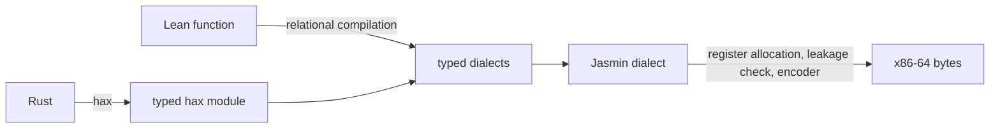

# CatCrypt compiler

A verified compiler for cryptographic code, written in Lean 4, in the tradition of Jasmin and
CT-CompCert. Its sources are Rust, through hax, Lean, and Jasmin, through an [importer](JINC_IMPORT.md). The
[overview](OVERVIEW.md) follows one function from source to machine code.

The code was written by AI under human guidance. Its theorems are machine-checked, and its emitted
code is tested against reference implementations.

## Main theorem

For a program the compiler accepts, the emitted bytes decode to a program that computes the value
of the source on a model of x86-64
([`haxc_correct_auto`](CatCrypt/Crypto/SecureCompilation/Haxc/RegionLinkCall.lean)), and two runs
that agree on public inputs have equal leakage traces
([`haxc_ct_proved_all`](CatCrypt/Crypto/SecureCompilation/Haxc/ComposeCTStraight.lean)). Both
theorems are about the decoded bytes, so the trusted base has no assembler.



## Compiler

The compiler takes Rust through hax or Aeneas, and Lean functions;
[PIPELINE.md](PIPELINE.md) describes each front and its theorem.

Every intermediate language is a typed SSA dialect with a Lean denotation, in the style of
lean-mlir.

The compiler is verified. Register allocation uses translation validation, as in CompCert: a
verified checker accepts or rejects the result of an untrusted allocator
([`ownedCheckMC_sound`](CatCrypt/Crypto/SecureCompilation/X86Backend/OwnedLprogTVChecked.lean)).

A run has a trace of branch outcomes, memory addresses and the operands of variable-time
instructions, under a named hardware timing regime
([`ConstantTimeRel`](CatCrypt/Crypto/SecureCompilation/CT/Leakage.lean)). The compiler also satisfies
robust compilation ([`haxc_rc_proved_all`](CatCrypt/Crypto/SecureCompilation/Haxc/RCInstance.lean)).

## Kernels

The compiler compiles orchestration: control flow and calls to field operations. Kernels (bignum
loops, carry chains, symmetric primitives and NTTs) are linked code, called under a
[contract](CatCrypt/Crypto/SecureCompilation/Haxc/LinkedKernel.lean). A kernel is produced in one of
four ways; the first three come with a theorem about the kernel's own code, not a compilation of its
source. A template, as in Fiat Cryptography, is a Lean function from parameters to a program, with
one denotation theorem over all parameters and a checked certificate per instance; we extend the
method from curve fields to
[lattice transforms](CatCrypt/Crypto/SecureCompilation/VIR/NegacyclicNttTemplate.lean),
[hash functions](CatCrypt/Crypto/SecureCompilation/HashTemplate/), GHASH and extension towers
([FIAT_TEMPLATES.md](FIAT_TEMPLATES.md)).
[Relational compilation](CatCrypt/Crypto/SecureCompilation/RelationalFront.lean), in the style of
Rupicola, derives a kernel from a functional specification in Lean. Existing optimised code, such as
s2n-bignum and CryptOpt output, is taken as given and proved correct by
[ascent](ASCENT_OVERVIEW_HIGHLEVEL.md). The [Jasmin importer](JINC_IMPORT.md) reads Jasmin source
with its own front end, a parser and a partial evaluator, which are trusted as `jasminc`'s front end
is, and compiles the resulting program through this compiler's back end; a theorem about an imported
kernel is a theorem about that program, such as constant time for formosa-keccak's permutation
([`keccakF1600_constant_time`](CatCrypt/Crypto/Jasmin/KeccakJincEmit.lean)).

## Descent, ascent and transfer

Correctness proofs use [three techniques](CORRECTNESS.md), which compose.

[Descent](CORRECTNESS.md#descent-the-verified-compiler) compiles a source to bytes and proves each
pass correct.

[Ascent](ASCENT_OVERVIEW_HIGHLEVEL.md) proves that given code computes a Lean function, by verified
decompilation in the line of Myreen's decompilation into logic and AutoCorres. Its results include
s2n-bignum's Montgomery multiplication
([`s2nMontmulP384_correct_addr`](CatCrypt/Crypto/SecureCompilation/Ascent/Demos/S2nMontmulP384Addr.lean))
and CryptOpt's Curve25519 multiplication
([`carryMul_correct_addr`](CatCrypt/Crypto/SecureCompilation/Ascent/CryptOptAddr.lean)). The same
technique applies to Rust extracted by hax
([`hax_ascend`](HaxAscent/Ascent/Coverage.lean)) and by Aeneas.

[Transfer](CORRECTNESS.md#transfer-parametricity-across-representations) proves a fact across a
change of representation, by parametricity.

## Applications

- [lean4lean](https://github.com/spitters/lean4lean) is a Lean kernel with verified limb arithmetic
  for natural numbers.
- [Verified native evaluation](https://github.com/spitters/catcrypt-verified-eval) is a Lean
  package whose tactic `verified_decide`, in place of `native_decide`, proves a closed decidable
  proposition from one run of this compiler's x86 machine model (`runBlockA`). A verified
  compiler for a fragment of Lean emits the bytes, and the decoder of `roundtrip_block6` reads
  them back, so Lean's code generator never runs the decision procedure.
- [Lean with verified mpn](https://github.com/spitters/lean4/tree/catcrypt-mpn-4.35.0) is Lean
  v4.35.0 whose non-GMP runtime runs bignum addition, subtraction, comparison, multiplication,
  bitwise operations and shifts on kernels emitted by this compiler.

## Example

```rust
pub fn incr_array(mut x: &mut [u32; 2]) { x[0] += 1 }
```

This function from the Aeneas test suite compiles to 120 bytes through the Aeneas front, with
[correctness and constant-time theorems](CatCrypt/Crypto/SecureCompilation/AeneasFront/Demo/Compiled.lean)
for a secret array, laid out with one 64-bit word per element.

```bash
lake exe cache get
lake build CatCrypt.Crypto.SecureCompilation.AeneasFront.Demo.Compiled
lake exe linked-kernel-emit --only aeneas_incr_array
```

[BUILDING.md](BUILDING.md) has every build and check command.

## Trusted base

The trusted base is the Lean kernel; the x86-64 model and decoder, transcribed from Jasmin's
semantics and the Sail model; the semantics of the source reading in hax-lean; the hax extractor; and
the contract of each linked kernel.

## Further reading

- [OVERVIEW.md](OVERVIEW.md): a worked example and related work.
- [HEADLINES.md](HEADLINES.md): each theorem with its hypotheses.
- [PIPELINE.md](PIPELINE.md): the stages, each with its check and theorem.
- [BENCHMARKS.md](BENCHMARKS.md): timings against production implementations and `jasminc`.
- [NAVIGATION.md](NAVIGATION.md): where each subsystem lives.
