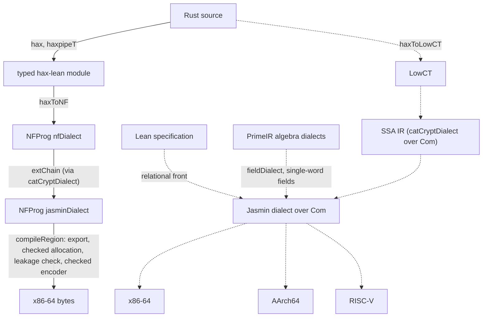

# catcrypt-compiler

A compiler for cryptographic code, written in the Lean 4 proof assistant together
with its correctness proofs. It accepts a program as extracted Rust or as a Lean
specification, lowers it through typed dialects that each carry a Lean denotation,
and emits x86-64 machine code inside Lean. Instruction selection to x86-64, AArch64 and
RV64 is proved for straight-line register code over virtual registers, without register
allocation. The design draws on
[AUCurves](https://github.com/AU-COBRA/AUCurves), bedrock2, Rupicola and
[Jasmin](https://github.com/jasmin-lang/jasmin) ([PROVENANCE.md](PROVENANCE.md)).

The package builds with the Lean toolchain `v4.35.0` ([lean-toolchain](lean-toolchain));
[BUILDING.md](BUILDING.md) gives the setup and every build and check command.

## The pipeline

The hax compiler `haxc` compiles along one line,
`compileA = haxToNF → extChain → compileRegion`: a typed hax-lean module to a
structured program of the Jasmin dialect, then export, checked register allocation,
the leakage check and the checked x86-64 encoder. [PIPELINE.md](PIPELINE.md) draws it
with the check and the theorem of each stage. Three theorems state what `compileA`
guarantees of the bytes it returns. Value correctness
([`haxc_correct_auto`](CatCrypt/Crypto/SecureCompilation/Haxc/RegionLinkCall.lean))
holds for every result of `compileA`. Constant time of every decoding
([`haxc_ct_proved_all`](CatCrypt/Crypto/SecureCompilation/Haxc/ComposeCTStraight.lean))
holds under the hypotheses that the translation `haxToNF` of the module is constant time
(`HaxToNFCTLOn`), that the source runs to a value at one fuel from every admissible
entry state (`hterm`), and that the public labels agree with the layout (`PubLabelsOK`).
[`haxc_rc_proved_all`](CatCrypt/Crypto/SecureCompilation/Haxc/RCInstance.lean) restates
value correctness and constant time together as the gate conclusion, and as
`RobustCompilation 0` with a choice simulator; the second form holds for every compiler
that satisfies the gate conclusion with a deterministic target. The bytes are read by
the package's own decoder `decodeLprog` and run on its own x86-64 model `aMachine`. The
first three rows of the table below give the statements; `lake exe haxc` runs
`compileA` on a hax export ([BUILDING.md](BUILDING.md#run-the-hax-compiler)).

The levels below are those of the dialect tower. Each stage names the theorem that
states its correctness; the table below gives the statements.

1. Rust to LowCT. hax exports Rust to the AST of hax-lean, and the legacy front
   [`haxToLowCT`](CatCrypt/Crypto/Hax/HaxToLowCT.lean), which `compileA` does not use,
   translates it to the word-level command language LowCT. Its simulation theorem
   [`haxToLowCT_simulates_programT`](CatCrypt/Crypto/Hax/HaxToLowCTSim_ProgramTower.lean)
   holds for builtin tables that implement neither `array_update` nor `index`, so it
   covers programs without array operations.
2. A Lean specification to code, by relational compilation in the sense of Rupicola: a
   program is derived from a Lean function together with the proof that relates the
   two. The front [RelationalFront](CatCrypt/Crypto/SecureCompilation/RelationalFront.lean) compiles toward machine
   code ([`addMod251_source_eq_arm`](CatCrypt/Crypto/SecureCompilation/RelationalFrontMachine.lean)), and the reifier
   `reifyImp%` compiles a Lean function to Rust
   ([HAX_RUST.md](HAX_RUST.md#2-pure-lean--rust),
   [`edwardsAdd_endToEnd`](CatCrypt/Hax/ReifyImpEndToEnd.lean)).
3. LowCT to the SSA IR: [`transU_denote`](CatCrypt/Crypto/SecureCompilation/Dialects/TranslateDialectUnifiedDenote.lean).
4. The SSA IR to the Jasmin dialect:
   [`cryptoDialectToJasminCom_denote_eq'`](CatCrypt/Crypto/SecureCompilation/VIR/DialectToJasminComCorrect.lean). Stages 3
   and 4 compose in
   [`rustToJasminCom_endToEnd_unconditional`](CatCrypt/Crypto/SecureCompilation/VIR/CompilerCorrectnessExtracted.lean).
5. Instruction selection to x86-64, AArch64 and RV64, over string-named virtual
   registers without register allocation:
   [`com_x86_e2e`](CatCrypt/Crypto/SecureCompilation/ScalarLinX86Demo.lean), [`com_arm_e2e`](CatCrypt/Crypto/SecureCompilation/ScalarLinNeutralDemo.lean),
   [`com_riscv_e2e`](CatCrypt/Crypto/SecureCompilation/MultiBackendDemo.lean).
6. Register allocation on x86-64. A checker compares each allocated body with its
   input, which is translation validation
   ([CORRECTNESS.md](CORRECTNESS.md#proofs-checks-and-translation-validation-in-haxc)):
   [`ownedCheckMC_sound`](CatCrypt/Crypto/SecureCompilation/X86Backend/OwnedLprogTVChecked.lean).
7. Emitted loops in the linear machine model: the export node of a runtime-count loop,
   [`singleLoop_export_faithful_gate`](CatCrypt/Crypto/SecureCompilation/X86Backend/ExportCertGate.lean),
   and the loop theorems of [HEADLINES.md](HEADLINES.md#emitted-loops).
8. Encoding to bytes and statements on decoded bytes:
   [`roundtrip_block`](CatCrypt/Crypto/SecureCompilation/X86Backend/SailX86BlockRoundtrip.lean),
   [`bytesCTCheck_sound`](CatCrypt/Crypto/SecureCompilation/X86Backend/DecodedCT.lean).
9. The ascent, from code back to a specification. On the blocks that the backend
   printed it is verified decompilation in the sense of Myreen's decompilation into
   logic ([ASCENT.md](ASCENT.md#verified-decompilation-of-the-projects-compiler-output)),
   stated over a Lean transcription of the printed text:
   [`paShippedBytes_correct`](CatCrypt/Crypto/SecureCompilation/Ascent/Demos/Ed25519PointAddBytes.lean). On code written
   elsewhere: [`s2nMontmulP384_correct_addr`](CatCrypt/Crypto/SecureCompilation/Ascent/Demos/S2nMontmulP384Addr.lean).

## The guarantees

Each row states one result; the Lean name links to its source file.

| What is proved | For which programs | Lean |
|---|---|---|
| When `compileA` returns `(P, bytes)` for a hax module `m` under the layout `σ`, the bytes decode under the package's decoder `decodeLprog` to a program, and every value of a source run of `m` from an entry state satisfying `σ.Regions` is read back by `σ` from a halting run of that program on the package's x86-64 model `aMachine`, which restores the stack register and leaves memory outside the frame and the pointer regions unchanged; for a module with a linked function, the run goes through the call to the decoded code of the callee. | every module that `compileA` accepts whose linked functions have distinct names and are linked kernels (`LinkedKernel`); both hold without linked functions | [`haxc_correct_auto`](CatCrypt/Crypto/SecureCompilation/Haxc/RegionLinkCall.lean) |
| Every decoding of those bytes is constant time under the leakage regime `ctRegime`: two runs from entry states that satisfy `σ.Regions` and agree on the public data of `σ`, from the first of which the module has a source run (from both, for a module with linked functions), have equal leakage traces. | modules that `compileA` accepts whose translation `haxToNF` is constant time at the secrecy record (`HaxToNFCTLOn`, a semantic hypothesis on the translated program; the Boolean level check `haxToNFCTBL` implies it), whose prepared source body runs to a value at one fuel from every entry state satisfying `σ.Regions` and a precondition `Pre` (`hterm`), whose public labels agree with the public data of the layout (`PubLabelsOK`), and whose layout names are distinct | [`haxc_ct_proved_all`](CatCrypt/Crypto/SecureCompilation/Haxc/ComposeCTStraight.lean) |
| Value correctness and constant time hold together as the gate conclusion `GateConclusion`. The second conjunct restates the gate conclusion as `RobustCompilation 0` between the real observation (the result read back from the target run with its leakage trace) and an ideal observation (the source value with a trace that the choice simulator `RCGate.simLeak`, defined by `Classical.epsilon`, picks from the public projection `pubOf σ`); a context chooses only the entry state. This conjunct holds for every compiler that satisfies the gate conclusion with a deterministic target. | as for the two rows above, with the Boolean level check `haxToNFCTBL` in place of `HaxToNFCTLOn` and `hterm` on every entry state satisfying `σ.Regions` | [`haxc_rc_proved_all`](CatCrypt/Crypto/SecureCompilation/Haxc/RCInstance.lean), [`haxc_gate_proved_all`](CatCrypt/Crypto/SecureCompilation/Haxc/RCInstance.lean) |
| An evaluation of a hax-lean program by `evalImp` is matched by a run of the LowCT execution relation `RustExec` on its translation by the legacy front `haxToLowCT`, from related entry states to related exit states. | programs that `haxToLowCT` translates and the scope check `simScope` accepts, whose conditions are scalar (`condsScalar`), for builtin tables whose calls agree with the leaf specification (`LeafCallAgreesArgs`) and which implement neither `array_update` nor `index` | [`haxToLowCT_simulates_programT`](CatCrypt/Crypto/Hax/HaxToLowCTSim_ProgramTower.lean) |
| The SSA code that the unified translation `transU` produces for a LowCT program at a given entry environment and fuel, followed by any continuation, denotes that continuation at a valuation consistent with the environment the source semantics `semU` returns. The translation unrolls each data-dependent loop to the trip count of that environment and decides each one-armed conditional on the guard value in that environment, so the emitted program is specific to the entry environment. | counted loops, one-armed conditionals, sequencing and data-dependent `while`, nested to any depth (`IsCoveredSU`), when `transU` succeeds and `semU` returns at that fuel | [`transU_denote`](CatCrypt/Crypto/SecureCompilation/Dialects/TranslateDialectUnifiedDenote.lean) |
| Lowering a straight-line program of the SSA IR to the Jasmin dialect preserves the value it computes; a leaf call (`extCall`) denotes the default value of its type on both sides. | every program the lowering accepts | [`cryptoDialectToJasminCom_denote_eq'`](CatCrypt/Crypto/SecureCompilation/VIR/DialectToJasminComCorrect.lean) |
| From LowCT to the Jasmin dialect, the compiled program returns the value that the machine-word semantics `semScalar` of the source leaves in one tracked output variable. | straight-line word code, counted loops and conditionals (`IsCoveredSCtl`) that the translation and the lowering both accept, on entry states where `semScalar` returns, with every leaf call given the default value of its type; the `_topLevel_` form applies to programs that read no input | [`rustToJasminCom_endToEnd_unconditional`](CatCrypt/Crypto/SecureCompilation/VIR/CompilerCorrectnessExtracted.lean) |
| The instruction block selected for a Jasmin-dialect program, run in register models of x86-64, AArch64 and RV64 whose registers are named by strings, from virtual registers `v0 … v(n-1)` holding the inputs, leaves the program's value in the virtual result register; no register is allocated. | straight-line programs over 64-bit registers whose operations are add, sub, mul, and, or, xor, high multiply, immediate shifts and constants (`ComOK`); on x86-64, with immediate shift amounts below `2^64` | [`com_x86_e2e`](CatCrypt/Crypto/SecureCompilation/ScalarLinX86Demo.lean), [`com_arm_e2e`](CatCrypt/Crypto/SecureCompilation/ScalarLinNeutralDemo.lean), [`com_riscv_e2e`](CatCrypt/Crypto/SecureCompilation/MultiBackendDemo.lean) |
| Every halting bounds-checked run of a body from counter `0` is matched by a halting run of its register-allocated form from the same state; the end states agree on the output registers, the arrays and the word memory. | pairs of x86 linear bodies that the checker `ownedCheckMC` accepts | [`ownedCheckMC_sound`](CatCrypt/Crypto/SecureCompilation/X86Backend/OwnedLprogTVChecked.lean) |
| A model of an emitted countdown loop (the do-while `whileLinstrRM` over the body `loopBodyFullMN`), run in the linear machine model with memory from a state whose guard register holds a positive guard value, halts with the value of the source loop `ComL.whileNz` in its accumulator register. A guard of `0` is excluded; the exported do-while `whileLcmdNz` has no zero-trip guard. | data-dependent countdown loops whose guard register is the counter and whose update body is straight-line code in the stack-memory fragment `ScalarMemN` | [`whileMem_export_faithful_comL_uncond_trips`](CatCrypt/Crypto/SecureCompilation/VIR/JasminLsemMemSourceTieWhileUncond.lean) |
| The export node of a runtime-count loop halts under `lsemFuelMemF` from the ABI entry with the output array decoding to the denotation of the source program. | programs with one runtime-count loop accepted by `singleLoopB` | [`singleLoop_export_faithful_gate`](CatCrypt/Crypto/SecureCompilation/X86Backend/ExportCertGate.lean) |
| The bytes that the encoder writes for a block decode to the block under the register naming of the allocation, instruction by instruction, with no byte left over. | x86-64 blocks of the instruction forms accepted by `blockCovered` and `mulxRdxOk` | [`roundtrip_block`](CatCrypt/Crypto/SecureCompilation/X86Backend/SailX86BlockRoundtrip.lean) |
| Two runs of a decoded program from index `0`, from states that agree on the public set and with steps that respect the frame separation, have equal leakage traces. | decoded x86-64 programs that the checker `bytesCTCheck` accepts; it accepts the decoded bytes of the exporter's `mpn_mul_1` body (before `optimizeLprog`) and the decoded bytes of the hand-written `fe25519_add` kernel | [`bytesCTCheck_sound`](CatCrypt/Crypto/SecureCompilation/X86Backend/DecodedCT.lean), [`mul1Node_bytesCT`](CatCrypt/Crypto/SecureCompilation/X86Backend/DecodedCTKernels.lean), [`feAddFramed_bytesCT`](CatCrypt/Crypto/SecureCompilation/X86Backend/DecodedCTKernels.lean) |
| Two runs from states that agree on the public registers leak the same trace of branch events, without direction, and memory accesses, as base-register name and offset. The statement is about a model of structured control flow; no emitted branch is covered. | conditionals with public guards and loops with literal trip counts, over straight-line blocks whose index registers are public and which write no public register (`CFControlled`) | [`owned_ct_control_flow`](CatCrypt/Crypto/SecureCompilation/X86Backend/MachineConstantTime.lean) |
| Output noninterference at the source: a program accepted by the analysis `cmdCT`, run from two states that agree on public data, ends in states that agree on public data. The statement has no leakage trace. | programs the analysis `cmdCT` accepts, which compute on no secret data, under `CMOVInvariant`, which holds for a select only when its two sources are the same slot | [`cmdCT_sound`](CatCrypt/Crypto/Jasmin/LowCTCTAnalysis.lean) |
| The encoding of the sum of two elements of `ZMod 251` is the content of the result register after the compiled program runs from registers holding the encoded operands, on AArch64 and RV64. | the hand-written kernel `fieldAddMod251Com`, packaged with its realization square as `addMod251RealizedKernel`, over string-named virtual registers | [`addMod251_source_eq_arm`](CatCrypt/Crypto/SecureCompilation/RelationalFrontMachine.lean), [`addMod251_source_eq_riscv`](CatCrypt/Crypto/SecureCompilation/RelationalFrontMachine.lean) |
| The Rust text printed for a Lean function, as the hax frontend reads it back, evaluates under `evalImp` to the encoding of the function's value, from some fuel on. | the Edwards addition `edwardsAddLean` over any carrier whose encoding holds no control-flow value, with the leaf calls interpreted by the table `edBi` | [`edwardsAdd_endToEnd`](CatCrypt/Hax/ReifyImpEndToEnd.lean) |
| When the reading of a hax literal in the Rust monad returns a value and an environment, the run of the literal under hax-lean's `denote'` returns their encodings, from some fuel on. | every `ImpExpr` literal, for a call interpretation that agrees with the builtin table (`AppOk`) | [`toRustMS_sim`](HaxAscent/RustSemantics/ToRustMS.lean) |
| Total Hoare triples of the reading, with the postcondition that the returned value encodes `f a`, give the function correspondence `FnCorres` between the literal and the Lean function `f`. | every `ImpExpr` literal whose entry environment encodes the environment of the reading, under `AppOk` | [`fnCorres_of_toRustMS_triple`](HaxAscent/RustSemantics/TripleToFnCorres.lean) |
| The bytes that this package's encoder writes for the transcribed `ed25519_point_add` block decode to that block, which on the address machine `runBlockA` stores the four coordinates of the extended-coordinate addition formula. | the 4909-instruction Lean transcription of the backend's `ed25519_point_add` text, on disjoint cells and inputs below `2^255 − 19`; the bytes are the encoder's, not the assembler's output for that text | [`paShippedBytes_correct`](CatCrypt/Crypto/SecureCompilation/Ascent/Demos/Ed25519PointAddBytes.lean) |
| The transcribed x86-64 blocks that the backend printed for the Ed25519 implementation store the values of their specifications: the mixed addition; the input raised to `2^255 − 21` modulo `2^255 − 19`; the encoding `y + 2^255 · (x mod 2)` of the affine point; `x mod L`; `(a · b + c) mod L`. | `ed25519_madd`, `ed25519_invert`, `ed25519_compress`, `ed25519_sc_reduce`, `ed25519_sc_muladd`, each under its separation hypotheses between buffers and stack frame; `madd` and `invert` on inputs below `2^255 − 19` and `compress` on a third coordinate below it; `madd` and `compress` for callees that meet their specifications (`MaddCallees`, `CompressCallees`); `invert`, and `compress` through its inversion call, under call models that restore `%rsp` and the callee-saved registers on return, in place of the `pushq`/`popq` frames the transcription omits | [`maddShipped_correct_cross`](CatCrypt/Crypto/SecureCompilation/Ascent/Demos/Ed25519MaddShippedProof.lean), [`invertShipped_correct`](CatCrypt/Crypto/SecureCompilation/Ascent/Demos/Ed25519InvertShippedProof.lean), [`compressShipped_correct_addr`](CatCrypt/Crypto/SecureCompilation/Ascent/Demos/Ed25519CompressShippedProof.lean), [`scReduceShipped_correct_addr`](CatCrypt/Crypto/SecureCompilation/Ascent/Demos/Ed25519ScReduceShippedProof.lean), [`scMuladdShipped_correct_addr`](CatCrypt/Crypto/SecureCompilation/Ascent/Demos/Ed25519ScMuladdShippedProof.lean) |
| With `%rsi`, `%rdx` and `%rdi` pointing at `x`, `y` and the output, and `x · y ≤ 2^384 · p384`, the six output words are below `p384` and equal `x · y · (2^384)⁻¹` in `ZMod p384`. The three buffers may overlap. | s2n-bignum's hand-written `bignum_montmul_p384` as imported, 264 instructions, on the address machine `runBlockA`; the form for inputs below `p384` is `s2nMontmulP384_correct_reduced` | [`s2nMontmulP384_correct_addr`](CatCrypt/Crypto/SecureCompilation/Ascent/Demos/S2nMontmulP384Addr.lean), [`s2nMontmulP384_correct_reduced`](CatCrypt/Crypto/SecureCompilation/Ascent/Demos/CertifyThirdPartyDemo.lean) |
| The package's encoding of that block decodes to 264 instructions that store the same Montgomery product at `%rdi`, under the same bound on `x · y`. | the encoded bytes of `bignum_montmul_p384`, on the name-keyed machine `runBlock`, which reads `y` from the bank named `%rcx` and keeps the three buffers apart | [`s2nMontmulP384Bytes_correct`](CatCrypt/Crypto/SecureCompilation/Ascent/Demos/S2nMontmulP384Bytes.lean) |
| With `%rsi`, `%rdx` and `%rdi` pointing at `x`, `y` and the output, and every input limb below `2^54`, the five radix-`2^51` output words have a value congruent to the product of the values at `x` and `y` modulo `2^255 − 19` (the congruence of fiat-crypto's `mul_correct`; no bound on the output limbs is stated). The output may overlap either input. | CryptOpt's `fiat_curve25519_carry_mul` as imported, 167 instructions, on the address machine `runBlockA`; the two inputs and the 136-byte frame below `%rsp − 128` are pairwise apart, and the output is apart from the frame | [`carryMul_correct_addr`](CatCrypt/Crypto/SecureCompilation/Ascent/CryptOptAddr.lean) |
| With `%rsi` and `%rdi` pointing at `x` and the output, the four output words have a value congruent to the square of the value at `x` modulo `2^255 − 19` (fiat-crypto's `sqr_correct`). | CryptOpt's `fiat_curve25519_solinas_square` as imported, 99 instructions, on `runBlockA`; the input, the output and the 48 bytes from `%rsp − 128` are pairwise apart | [`solinasSquare_correct_addr`](CatCrypt/Crypto/SecureCompilation/Ascent/CryptOptAddr.lean) |
| A body that corresponds to a specification at the fuelled x86 interpreter, placed after a label inside a larger program and followed by a return, satisfies the procedure specification of that label at the instruction set with calls. | bodies that contain no call or return and name `RSP` in no instruction (two Boolean checks), with labels fresh for the prefix and entry states at counter `0` | [`x86_procSpec_of_image_judgement`](CatCrypt/Crypto/SecureCompilation/Ascent/CorresIsaStackFrame.lean) |
| The x86 step of an instruction other than a control instruction commutes with a shift of the program counter and does not read the program; the branch condition does not read the counter. | every function name, prefix, body and suffix | [`x86_stepRelocates`](CatCrypt/Crypto/SecureCompilation/Ascent/CorresIsaRelocX86.lean) |
| ML-KEM (FIPS 203): decompression after compression is within `errorBound d` of the input in the centred distance modulo `q`; the inverse transform inverts the transform; the product in `Rq_kem` is the inverse transform of the base multiplication of the transforms. | compression parameters `1 ≤ d ≤ 12` over `q = 3329`; every coefficient vector; every pair of ring elements | [`decompress_compress_centered`](https://github.com/spitters/CatCrypt-core/blob/f85b1c2cc2b828ebe900d3538938d2b532db6cb7/CatCryptCore/Crypto/MLKEM/Compress.lean), [`invNttKem_nttKem`](https://github.com/spitters/CatCrypt-core/blob/f85b1c2cc2b828ebe900d3538938d2b532db6cb7/CatCryptCore/Crypto/MLKEM/Spec/Ntt.lean), [`rqKem_mul_eq_invNttKem`](https://github.com/spitters/CatCrypt-core/blob/f85b1c2cc2b828ebe900d3538938d2b532db6cb7/CatCryptCore/Crypto/MLKEM/Spec/Ntt.lean) (in CatCrypt-core) |
| ML-DSA (FIPS 204): the size formulas of Algorithms 22, 24 and 26, evaluated at the parameter set `MLDSA65Params`, give 1952, 4032 and 3309 bytes, the values of FIPS 204 Table 2. | the parameter set `MLDSA65Params`; the same module evaluates the formulas at ML-DSA-44 and ML-DSA-87; no encoder's output length is involved | [`mldsa65_pk_size`](CatCrypt/Crypto/MLDSA/ConcreteParams.lean), [`mldsa65_sk_size`](CatCrypt/Crypto/MLDSA/ConcreteParams.lean), [`mldsa65_sig_size`](CatCrypt/Crypto/MLDSA/ConcreteParams.lean) |
| ML-DSA: `useHint` applied to the hint that `makeHint` produces returns the high bits of `r + z` modulo `q`. | `0 ≤ r < q`, `−γ2 ≤ z ≤ γ2`, and `γ2` one of the two standard values (`IsGamma2`) | [`useHint_makeHint`](CatCrypt/Crypto/MLDSA/Spec/Rounding.lean) |
| The Montgomery model of the P-256 field satisfies the law of `pow` (the power to the exponent that the little-endian 64-bit limbs encode) and the laws of `from_bytes` and `to_bytes` with encodings of 32 bytes. | valid representations of `fp256MontCtModel`, exponents and byte arrays given as digit arrays | [`fp256MontCtModel_powLaws`](CatCrypt/Crypto/PrimeIR/Proof/Fp256MontBytesPow.lean), [`fp256MontCtModel_byteLaws`](CatCrypt/Crypto/PrimeIR/Proof/Fp256MontBytesPow.lean) |

[HEADLINES.md](HEADLINES.md) states each compiler headline with its hypotheses, and
[NAVIGATION.md](NAVIGATION.md) locates every subsystem and its main theorem.

### Functional correctness

- Dialect lowering. When the lowering from the SSA IR to the Jasmin dialect
  succeeds on a straight-line program, the lowered program denotes the transport of the
  source denotation, with each leaf call denoting the default value of its type on both
  sides ([`cryptoDialectToJasminCom_denote_eq'`](CatCrypt/Crypto/SecureCompilation/VIR/DialectToJasminComCorrect.lean)). [`compileVia_comp_correct`](CatCrypt/Crypto/SecureCompilation/VIR/LoweringDataComp.lean)
  composes two dialect lowerings and states the result for the Jasmin-IR evaluator
  [`runProg`](CatCrypt/Crypto/SecureCompilation/VIR/JasminPrintSemCorrect.lean), given per-operation transport hypotheses, leaf agreement ([`LeafAgrees`](CatCrypt/Crypto/SecureCompilation/VIR/JasminPrintSemCorrect.lean))
  and a straight-line lowered program. [`fieldToJasminWord_denote`](CatCrypt/Crypto/SecureCompilation/Algebraic/FieldToJasminWord.lean)
  lowers [`fieldDialect`](CatCrypt/Crypto/SecureCompilation/VIR/FieldDialect.lean) programs over a single-word prime field to the Jasmin
  dialect with preserved denotation.
- Rust front. [`rustToJasminCom_endToEnd_unconditional`](CatCrypt/Crypto/SecureCompilation/VIR/CompilerCorrectnessExtracted.lean) equates the Jasmin value with
  the value that the machine-word semantics [`semScalar`](CatCrypt/Crypto/SecureCompilation/Dialects/TranslateDialectScalarDenote.lean) leaves in the tracked output,
  where `semScalar` gives each leaf call the default value of its type, and asserts
  that some post-state related to the LowCT execution relation [`RustExec`](CatCrypt/Crypto/Jasmin/LowCTExec.lean)
  exists; the `RustExec` state is not related to the `semScalar` entry state.
  [`rustToJasminCom_endToEnd_rustexec_adeq_topLevel`](CatCrypt/Crypto/SecureCompilation/Dialects/RustExecSemScalarBridge.lean)
  equates the Jasmin value with the `RustExec` output word on [`IsCoveredAdeq`](CatCrypt/Crypto/SecureCompilation/Dialects/RustExecSemScalarBridge.lean), for
  programs that read no input and whose arithmetic cannot overflow for any `u64`
  valuation. [`transU_to_jasminCom_endToEnd`](CatCrypt/Crypto/SecureCompilation/VIR/RustToJasminComWhile.lean)
  states the same for programs with data-dependent `while` loops, over the fuel-bounded
  semantics [`semU`](CatCrypt/Crypto/SecureCompilation/Dialects/TranslateDialectUnifiedDenote.lean), for the program that `transU` emits for one entry environment;
  that program has each loop unrolled and each conditional decided at that environment.
  The legacy translation `haxToLowCT` from hax-lean's AST to LowCT has its own
  simulation theorems ([`haxToLowCT_simulates_programT`](CatCrypt/Crypto/Hax/HaxToLowCTSim_ProgramTower.lean), for programs without array operations, and
  siblings, [CatCrypt/Crypto/Hax/AGENTS.md](CatCrypt/Crypto/Hax/AGENTS.md)).
- Machine code. For a straight-line [`Com`](CatCrypt/Crypto/SecureCompilation/VIR/Core.lean) over [`ComOK`](CatCrypt/Crypto/SecureCompilation/ScalarLinDeBruijn.lean) (64-bit add, sub, mul, and,
  or, xor, widening high multiply, immediate shifts, constants), the block that the
  scalar instruction selection produces, run in a register model whose registers are
  named by strings from virtual registers `v0 … v(n-1)` holding the inputs, leaves
  `Com.denote` in the virtual result register; no register is allocated ([`com_x86_e2e`](CatCrypt/Crypto/SecureCompilation/ScalarLinX86Demo.lean), [`com_arm_e2e`](CatCrypt/Crypto/SecureCompilation/ScalarLinNeutralDemo.lean), [`com_riscv_e2e`](CatCrypt/Crypto/SecureCompilation/MultiBackendDemo.lean)). [`comToArmLsem_correct`](CatCrypt/Crypto/SecureCompilation/ARMBackend/ComToArmLsem.lean)
  and [`comToRiscvLsem_correct`](CatCrypt/Crypto/SecureCompilation/RISCVBackend/ComToRiscvLsem.lean) restate the result on the
  base arithmetic-logic subset over the [`runBBlock`](CatCrypt/Crypto/SecureCompilation/ARMBackend/ArmModel.lean) and RV64 machine models.
  [`riscvStep64_sail_grounded`](CatCrypt/Crypto/SecureCompilation/RISCVBackend/ComToRiscvLsem.lean) equates the destination value of each base RV64
  instruction step with that of an `execute_RTYPE` clause, under an alignment of the
  string-named register file with the 32 Sail registers; the clause is copied from
  [sail-riscv-lean](https://github.com/opencompl/sail-riscv-lean) into
  [SailRiscv64Refinement](CatCrypt/Crypto/SecureCompilation/RISCVBackend/SailRiscv64Refinement.lean). The encoders of both backends carry
  decode round trips against decode field splits transcribed from the Sail decode
  clauses.
- Emitted loops. [`singleLoop_export_faithful_gate`](CatCrypt/Crypto/SecureCompilation/X86Backend/ExportCertGate.lean)
  runs the export node of a runtime-count loop in the linear machine model and equates
  the output array with the source denotation ([`ComL.denote`](CatCrypt/Crypto/SecureCompilation/VIR/JasminLprogExport/ExportLoops.lean)).
  The `VIR.JasminLsemMem*` theorems run models of the emitted counter and countdown
  loops under run-schedule or entry hypotheses, and relate the flat machine run of a
  loop nest or call chain to a structured machine fold; [HEADLINES.md](HEADLINES.md)
  lists them with their hypotheses.
- Ascent. The ascent proves that a program at one of the compiler's low levels (a
  LowCT command, an x86 or RV64 instruction list, x86 bytes) computes a Lean
  specification ([ASCENT.md](ASCENT.md)). [`paShippedBytes_correct`](CatCrypt/Crypto/SecureCompilation/Ascent/Demos/Ed25519PointAddBytes.lean) shows that the
  bytes that the package's encoder writes for a Lean transcription of the backend's
  `ed25519_point_add` text decode to a block that computes the extended-coordinate
  addition formula on inputs below `2^255 − 19`. For code written outside the
  project, [`s2nMontmulP384_correct_addr`](CatCrypt/Crypto/SecureCompilation/Ascent/Demos/S2nMontmulP384Addr.lean) states the
  Montgomery product of s2n-bignum's P-384 multiplication, and
  [CERTIFYING_THIRD_PARTY_CODE.md](CERTIFYING_THIRD_PARTY_CODE.md) describes the certification path.

### Constant time and noninterference

- x86-64, decoded bytes. [`bytesCTCheck_sound`](CatCrypt/Crypto/SecureCompilation/X86Backend/DecodedCT.lean): for a decoded
  program that the checker `bytesCTCheck` accepts, two runs from index `0` whose steps
  respect the frame separation, from states that agree on the public set, have equal
  leakage traces; the trace records effective address values and branch outcomes.
  [`mul1Node_bytesCT`](CatCrypt/Crypto/SecureCompilation/X86Backend/DecodedCTKernels.lean) and
  [`feAddFramed_bytesCT`](CatCrypt/Crypto/SecureCompilation/X86Backend/DecodedCTKernels.lean) show that the checker accepts the
  decoded bytes of the exporter's `mpn_mul_1` body (before `optimizeLprog`) and of the
  hand-written `fe25519_add` kernel.
- x86-64, straight-line. [`toLprogPhysAbi_gather_constant_time`](CatCrypt/Crypto/SecureCompilation/X86Backend/AllocCTPreservation.lean):
  an exported function body with direct addressing that gathers to an x86 instruction
  block has a leakage trace (base-register names and displacements) determined by the
  instruction list alone. Address values are covered by `bytesCTCheck_sound`.
- x86-64, structured control flow, on a model IR. [`owned_ct_control_flow`](CatCrypt/Crypto/SecureCompilation/X86Backend/MachineConstantTime.lean): a block of
  the model IR [`OwnedCF`](CatCrypt/Crypto/SecureCompilation/X86Backend/MachineConstantTime.lean) built from conditionals with public guards and loops with
  literal trip counts leaks the same trace (branch events without direction, memory
  accesses as base-register name and offset) from any two states that agree on the public
  registers. `OwnedCF` is not tied to the emitted [`Lcmd`](CatCrypt/Crypto/SecureCompilation/VIR/JasminLprogExport/Types.lean) or to bytes, so
  no emitted branch is covered.
- Source. [`cmdCT_sound`](CatCrypt/Crypto/Jasmin/LowCTCTAnalysis.lean): a program accepted by the analysis [`cmdCT`](CatCrypt/Crypto/Jasmin/LowCTCTAnalysis.lean), run from two
  public-equivalent states, reaches public-equivalent states (output noninterference;
  the statement has no leakage trace), under the
  hypothesis [`CMOVInvariant`](CatCrypt/Crypto/Jasmin/LowCTCTAnalysis.lean), which holds for a
  select only when its two sources are the same slot; `cmdCT` admits no computation
  on secret data. `cmdCT` accepts a
  data-dependent loop exactly when its guard is public
  ([`cmdCT_RWhileNz_iff`](CatCrypt/Crypto/SecureCompilation/LowCTVartimeLeak.lean)); for example, it accepts a
  two-node model of the early-terminating modular inverse (a loop over an opaque step
  call) under an all-public level table and rejects it under a secret guard
  ([`vartimeInvert_public_only`](CatCrypt/Crypto/SecureCompilation/VartimeBignumInverse.lean)).

### Security ties

hax lets one Rust source serve as compiler input and as the model for computational
security proofs in the wider CatCrypt development, following
[The Last Yard](https://eprint.iacr.org/2023/185). The `*SecurityTie` modules equate
a dependency record built from the [`Com`](CatCrypt/Crypto/SecureCompilation/VIR/Core.lean) denotations of compiled kernels with a
record of the specification functions defined in the same module; for SHA-256,
[`toRoundDeps_eq_spec`](CatCrypt/Crypto/SecureCompilation/CompileFromHaxSecurityTie.lean)
equates the compiled Σ0, Σ1, Maj and Ch with the FIPS 180-4 formulas at the `Com`
denotation. No security proof consumes that record.

## Architecture

A cryptographic implementation has three parts: orchestration (protocol and control
flow), algebra (field, curve and polynomial arithmetic) and leaves (low-level
primitives). Each enters at its own level.

The solid line is the compile line `compileA` of `haxc` ([PIPELINE.md](PIPELINE.md)).
The dashed edges are the dialect tower over `Com`, the level of the kernel producers,
the `.jinc` importer, the relational front and the instruction selection to AArch64
and RV64.

- LowCT is the low-level constant-time command language
  ([LowCT.lean](CatCrypt/Crypto/Jasmin/LowCT.lean)), ported from AUCurves. hax-lean's AST
  translates to it, and Lean terms elaborate to it through [`reifyLowCT%`](CatCrypt/Crypto/Jasmin/LowCTReflect.lean).
- [`Com`](CatCrypt/Crypto/SecureCompilation/VIR/Core.lean) is the typed SSA framework, after
  [lean-mlir](https://github.com/opencompl/lean-mlir) through the Veir library. A
  dialect is a set of typed ops with a Lean denotation.
- The SSA IR is the dialect [`catCryptDialect`](CatCrypt/Crypto/SecureCompilation/VIR/CatCryptDialect.lean) over `Com`, the target of the LowCT
  front.
- The Jasmin dialect ([`jasminDialect`](CatCrypt/Crypto/SecureCompilation/VIR/JasminDialect.lean)) is the word-level target of every
  lowering. It reaches machine code through CatCrypt's own backend (the owned
  backend, which began as a port of the Jasmin compiler) or, as printed Jasmin text,
  through `jasminc`. Hand-written Jasmin leaves import through the same backend.
- The PrimeIR dialects ([`fieldDialect`](CatCrypt/Crypto/SecureCompilation/VIR/FieldDialect.lean), [`modArithDialect`](CatCrypt/Crypto/SecureCompilation/VIR/ModArithDialect.lean), [`polyDialect`](CatCrypt/Crypto/SecureCompilation/VIR/PolyDialect.lean),
  [`ecDialect`](CatCrypt/Crypto/SecureCompilation/VIR/EllipticCurveDialect.lean)) follow the MLIR dialects of
  [PrimeIR](https://github.com/fractalyze/prime-ir). Rust reaches them through the
  `primeir-hax` crate, whose traits name each operation
  ([CompileFromHaxPrimeIrFront](CatCrypt/Crypto/SecureCompilation/CompileFromHaxPrimeIrFront.lean)). `fieldDialect` lowers to the Jasmin dialect on
  single-word prime fields; the others carry denotations.
  [DIALECTS.md](CatCrypt/Crypto/SecureCompilation/VIR/DIALECTS.md) gives the
  lowering graph.
- The relational front ([RelationalFront](CatCrypt/Crypto/SecureCompilation/RelationalFront.lean)) takes a Lean
  operation with an encoding and a proved commuting square to a Jasmin-dialect program
  whose denotation is the encoded operation ([`RealizedKernel`](CatCrypt/Crypto/SecureCompilation/RelationalFront.lean)).

The covered source is the control spine of cryptographic code: straight-line leaf
calls, counted and public-condition loops, data-dependent loops, branchless select,
public-index array access, tuples, byte slices, and fixed-width and widening integer
arithmetic. SIMD intrinsics enter through an explicit-SIMD vector front with its own
semantics ([`translateDialectControlV_denote`](CatCrypt/Crypto/SecureCompilation/Dialects/TranslateDialectVsimdDenote.lean)).

## First example

[GETTING_STARTED.md](GETTING_STARTED.md) builds and runs
[CompilerHelloDemo](CatCrypt/Crypto/SecureCompilation/CompilerHelloDemo.lean). It compiles the routine
`fn f(a: u64, b: u64) -> u64 { let t = a.wrapping_mul(b); t.wrapping_add(a) }`, given
as a term of the front's input type, and prints AArch64 assembly.
[`srcArm_correct`](CatCrypt/Crypto/SecureCompilation/CompilerHelloDemo.lean) proves that the compiled block, run from virtual registers
holding the inputs, leaves the denotation of the compiled program in the virtual result
register; it is an instance of [`com_arm_e2e`](CatCrypt/Crypto/SecureCompilation/ScalarLinNeutralDemo.lean).

## Where to start

- [PIPELINE.md](PIPELINE.md): the hax compiler `compileA`, stage by stage, with its
  checks and theorems.
- [CompilerHelloDemo](CatCrypt/Crypto/SecureCompilation/CompilerHelloDemo.lean): a two-line routine compiled to
  AArch64 with its correctness theorem; [GETTING_STARTED.md](GETTING_STARTED.md) walks
  through it.
- [Ascent/Demos/Decide.lean](CatCrypt/Crypto/SecureCompilation/Ascent/Demos/Decide.lean): a kernel written in the
  `lowct%` notation lifted to its specification over `ZMod 2^64` by one tactic
  ([ASCENT.md](ASCENT.md#quick-start)).
- [CertifyThirdPartyDemo](CatCrypt/Crypto/SecureCompilation/Ascent/Demos/CertifyThirdPartyDemo.lean): the statement a
  caller uses for s2n-bignum's P-384 Montgomery multiplication, with the decoding of
  its bytes ([CERTIFYING_THIRD_PARTY_CODE.md](CERTIFYING_THIRD_PARTY_CODE.md)).
- [HEADLINES.md](HEADLINES.md) and [NAVIGATION.md](NAVIGATION.md): each headline theorem
  with its hypotheses, and the location of every subsystem.
- The table below indexes the remaining documents.

## Documentation

| Document | Contents |
|---|---|
| [GETTING_STARTED.md](GETTING_STARTED.md) | the first example |
| [PIPELINE.md](PIPELINE.md) | the compile line of `haxc` as a diagram, with the check and theorem of each stage |
| [DEMO.md](DEMO.md), [EXAMPLES.md](EXAMPLES.md) | the two fronts on worked examples; buildable example modules |
| [HEADLINES.md](HEADLINES.md) | the headline theorems with their hypotheses |
| [NAVIGATION.md](NAVIGATION.md) | where each subsystem lives, and how to find a theorem |
| [CAPABILITIES.md](CAPABILITIES.md) | each primitive with its modules, theorems and provenance class |
| [CORRECTNESS.md](CORRECTNESS.md) | how correctness is proved: descent, ascent, transfer, and how they compose |
| [ASCENT.md](ASCENT.md) | the ascent from code to Lean specifications; [ASCENT_OVERVIEW_HIGHLEVEL.md](ASCENT_OVERVIEW_HIGHLEVEL.md), [ASCENT_OVERVIEW_LEAN.md](ASCENT_OVERVIEW_LEAN.md) and [ASCENT_REFERENCE.md](ASCENT_REFERENCE.md) give the overview and the module reference |
| [CERTIFYING_THIRD_PARTY_CODE.md](CERTIFYING_THIRD_PARTY_CODE.md) | certifying existing machine code: the hax reference, the differential oracle and the ascent |
| [HAX_RUST.md](HAX_RUST.md) | Lean to Rust and back through hax |
| [FIAT_TEMPLATES.md](FIAT_TEMPLATES.md) | the field and lattice templates with their bounds certificates and byte-level theorems |
| [FIELD_TEMPLATES_VS_RUST.md](FIELD_TEMPLATES_VS_RUST.md) | field arithmetic: what the Rust ecosystem does and what the templates add |
| [THIR_GENERATOR.md](THIR_GENERATOR.md) | the deprecated THIR kernel generator and its theorems |
| [bench.md](bench.md) | performance ratios against production implementations |
| [BUILDING.md](BUILDING.md) | dependencies, builds, the `haxc` executable, checks, axiom audit, documentation generation |
| [PROVENANCE.md](PROVENANCE.md), [THIRD_PARTY_NOTICES.md](THIRD_PARTY_NOTICES.md) | design lineage; licences of ported material and dependencies |
| [docs/CompilerManual.lean](docs/CompilerManual.lean) | the [Verso](https://github.com/leanprover/verso) manual |
| [CatCrypt/Crypto/SecureCompilation/AGENTS.md](CatCrypt/Crypto/SecureCompilation/AGENTS.md) | the compiler's source directories, with per-directory indexes |

The [CatCrypt paper](https://eprint.iacr.org/2026/604) describes the full system;
[CITATION.cff](CITATION.cff) carries the citation metadata.
