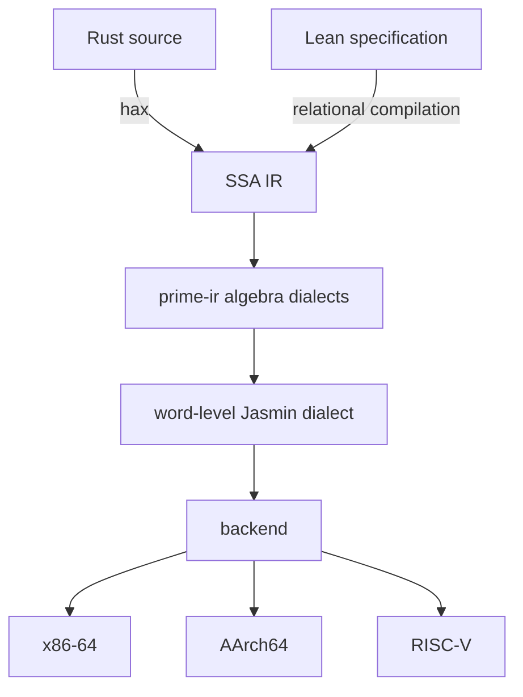

# catcrypt-compiler

A verified compiler for cryptography, built inside the Lean 4 proof assistant. A
crypto implementation has three parts: **orchestration** (the protocol and control
spine), **algebra** (field, curve, and polynomial mathematics), and **leaves**
(low-level hand-tuned primitives). CatCrypt gives each part a verified source,
lowers them through typed MLIR-style dialects (close to prime-ir), and emits constant-time x86-64,
AArch64, and RISC-V as machine bytes inside Lean. The compiler correctness is verified.
It is also constant time, and robust, but the precise proofs of these are under construction.
The design also takes inspiration from [AUCurves](https://github.com/AU-COBRA/AUCurves)

Today this structure is split by trust rather than by nature: orchestration in Rust,
but the constant-time-critical code hand-written in assembly, because `rustc` is not
trusted to preserve constant time. A verified compiler — constant-time preservation
included — lets each part be written at its natural level of abstraction and compiled
with trust, instead of dropping to hand-written assembly to keep control of timing.

> 🚧 **Under construction — experimental research prototype.** The interfaces, the
> covered source fragment, and the emitted surface are evolving; expect breaking
> changes. This is not a production tool.

**New here?** [Getting started](GETTING_STARTED.md) compiles a program to assembly in
one command.

## The three aspects

- **Orchestration** — Rust, extracted through hax. The extraction eliminates traits,
  generics, closures, and heap references, part of these transformations are proved correct in [hax-lean](https://github.com/AU-COBRA/hax-lean), and hands the
  covered control spine to LowCT, a low level constant-time language, and further to the dialect stack.
  These can also be authored directly in a lean AST or in lean surface, using rupicola style relational compilation.
- **Algebra** - The field, modular-arithmetic, elliptic-curve, and
  polynomial/NTT dialects are the verified analogs of
  [PrimeIR](https://github.com/fractalyze/prime-ir)'s MLIR dialects for cryptography
  — the algebraic tier that structures the compiler over a Jasmin-like substrate. A
  companion Rust library exposes these operations to hax, and a kernel that uses them
  compiles to the matching dialect operation.
- **Leaves** — Jasmin style structured assembly. The word-level Jasmin dialect is the compiler's MLIR
  substrate, and the compiler both compiles to it and imports from it (below).

For example, an ML-KEM protocol is edited where each part lives: the orchestration —
key schedule and message flow — in Rust or Lean; the algebra — the number-theoretic
transform and field arithmetic — in the MLIR/prime-ir dialects, targeted from a Lean
specification by relational compilation; and only the hand-tuned leaves stay at the
assembly level. The verified compiler carries constant time and correctness across
all three, so no part drops to assembly for trust.

## The dialect stack, and a two-way verified relationship with Jasmin

*Two source fronts converge on one IR; every arrow is a lowering proved to preserve
the denotation.*

The source lowers through typed dialects — an SSA intermediate representation, the
prime-ir algebraic dialects, and the word-level Jasmin dialect — down to a backend
that encodes instructions to bytes for x86-64, AArch64, and RISC-V. Every
dialect carries a Lean denotation, and every lowering is a Lean function proved to
preserve it, so a well-typed term denotes its specification by construction. The IR
structure follows [lean-mlir](https://github.com/opencompl/lean-mlir) (via the Veir
library); code generation is CatCrypt's own backend, which initiated from a port of
the jasmin compiler. Unverified LLVM code generation is also possible.

The compiler both compiles *to* [Jasmin](https://github.com/jasmin-lang/jasmin) and
imports *from* it, both inside Lean. The algebraic dialects lower to the Jasmin
dialect, which reaches x86 by either the bytes-direct encoder or Jasmin's own
verified compiler, reached by printing Jasmin text; and hand-written Jasmin leaves
are imported through the same backend. 
[PROVENANCE.md](PROVENANCE.md) records the low-level-IR
lineage: AUCurves, bedrock2, Rupicola.

## The guarantees

The pipeline preserves three properties from source to emitted bytes.

- **Functional correctness** — every emitted kernel denotes its source specification.
  Each lowering is proved to preserve denotation, so the guarantee holds for every
  well-typed term over the covered fragment. The Rust front's end-to-end result
  agrees with the source over the machine-word semantics and covers data-dependent
  loops. (Example: the lattice NTT compiles to the source polynomial multiply.)
- **Constant-time** — preserved over the full modern constructor set, including
  data-dependent loops: a loop is constant-time exactly when its guard is public,
  and the analyzer accepts a public-count loop and rejects a secret-dependent one.
  An information flow calculus allows us to write non-CT code too.
- **Security** — Hax allows us to use a protocol's source both as input to the catcrypt compiler and as a source for proofs in the computational model in CatCrypt, in the spirit of [Last yard](https://eprint.iacr.org/2023/185).

## What this repository contains

The compiler: the two fronts, the dialect stack, the equality-saturation optimizer,
the x86-64 / AArch64 / RISC-V backend, and the correctness theorems. The primitives
compiled through it — post-quantum, symmetric, and asymmetric cryptography, and
zero-knowledge proof systems — and their security chains live in the wider CatCrypt
development; this package is the engine they run through. The [CatCrypt
paper](CITATION.cff) describes the full system.

## Source coverage — the language of constant-time crypto

The covered source is the prime-ir algebra and the control spine that cryptography
is written in. It covers straight-line leaf calls, counted and public-condition
loops, branchless select, public-index array access, tuples, byte slices, and
fixed-width and widening integer arithmetic, over the prime-ir algebraic operations;
data-dependent loops are covered too. SIMD intrinsics enter through an explicit-SIMD
vector front with verified semantics (for example, AES and carry-less multiplication). The language
expresses both constant-time and variable-time kernels: a public-input variable-time
path such as RSA verification is accepted, and a secret-dependent one is rejected.
The relational front compiles Lean specifications directly.

## Build, dependencies, documentation

[GETTING_STARTED.md](GETTING_STARTED.md) compiles a program in one command;
[DEMO.md](DEMO.md) and [EXAMPLES.md](EXAMPLES.md) walk the two fronts and the
buildable example modules; [bench.md](bench.md) reports the measured performance; the
[manual](docs/CompilerManual.lean) — a [Verso](https://github.com/leanprover/verso)
document — gives the narrative and the headline theorems.

See [BUILDING.md](BUILDING.md). Dependencies resolve from git:
[`catcryptCore`](https://github.com/spitters/CatCrypt-core) (the CatCrypt
methodology library), `Veir`,
[`paramTransfer`](https://github.com/spitters/ParamTransfer) (the proof-transfer
bridge), `CompPoly`, [`hax-lean`](https://github.com/spitters/hax-lean) (the
typed hax front), `mathlib`. Generating the API reference and the proof blueprint
is covered in [BUILDING.md](BUILDING.md) as well.