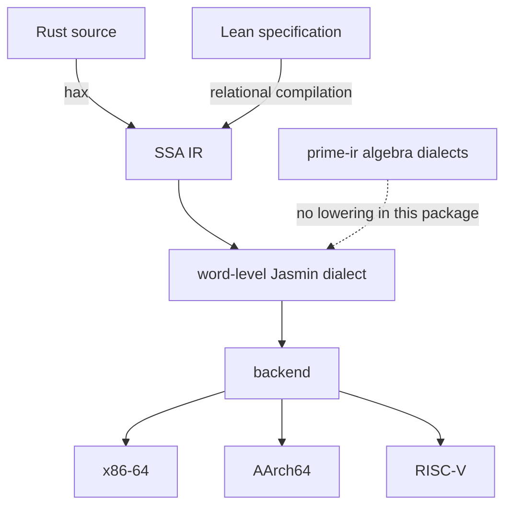

# catcrypt-compiler

A compiler for cryptographic code, written in the Lean 4 proof assistant together
with its correctness proofs. A cryptographic implementation has three parts:
orchestration (the protocol and its control flow), algebra (field, curve and
polynomial arithmetic) and leaves (low-level primitives). CatCrypt accepts each part
at its own level of abstraction, lowers it through typed MLIR-style dialects modelled
on [prime-ir](https://github.com/fractalyze/prime-ir), and emits x86-64, AArch64 and
RISC-V code inside Lean. The lowering from the SSA IR to the Jasmin dialect is proved
to preserve the denotation of every program it accepts. On each of the three
backends, a scalar instruction selection is proved to compute the source denotation
of a straight-line program over 64-bit registers. [The guarantees](#the-guarantees)
and [Limitations](#limitations) state each result with its fragment and its
hypotheses. The design draws on [AUCurves](https://github.com/AU-COBRA/AUCurves).

Production Rust implementations of cryptography are usually split into two layers:
orchestration in Rust, and the constant-time-critical code hand-written in assembly,
because `rustc` is not trusted to preserve constant time. A compiler proved to
preserve constant time lets each part be written at its natural level of
abstraction.

CatCrypt is an experimental research prototype, not a production tool. Its
interfaces, the covered source fragment and the emitted surface change without
notice.

## The three parts

- Orchestration: Rust, exported by hax to the typed AST of
  [hax-lean](https://github.com/spitters/hax-lean), whose AST and evaluator the
  package's hax front reads. hax-lean's own passes (removal of references, local
  mutation, loops and early returns) carry denotation-preservation proofs. The hax
  export from Rust is outside the proofs, trait methods reach the compiler as named
  calls, and complex generic types fall back to an unknown type (hax-lean's
  `LIMITATIONS.md`). The
  program is translated to LowCT, a low-level constant-time command language, and
  from there to the dialect stack. Orchestration can also be written directly in
  Lean, as a LowCT term or as a Lean function compiled relationally in the style of
  Rupicola.
- Algebra: the field, modular-arithmetic, elliptic-curve and polynomial/NTT dialects
  are Lean dialects modelled on [PrimeIR](https://github.com/fractalyze/prime-ir)'s
  MLIR dialects for cryptography. In this package none of them has a `Com`-level
  lowering to the word-level Jasmin dialect
  ([DIALECTS.md](CatCrypt/Crypto/SecureCompilation/VIR/DIALECTS.md) gives the
  lowering graph). Rust code reaches them through the `primeir-hax` crate, whose
  `Field`, `ModArith` and `EcGroup` traits name each operation; the front recognises
  a call by its method name and emits the matching dialect operation
  (`CatCrypt/Crypto/SecureCompilation/CompileFromHaxPrimeIrField.lean`,
  `CatCrypt/Crypto/SecureCompilation/CompileFromHaxPrimeIrFront.lean`). The crate is
  not part of this package.
- Leaves: Jasmin-style structured assembly. Jasmin is presented as an MLIR-style
  dialect, and the compiler both compiles to it and imports from it (below).

## The dialect stack and Jasmin

*Two source fronts reach one SSA IR. [The guarantees](#the-guarantees) name the
theorems behind the arrows and their fragments; the hax export is outside the
proofs.*

The source lowers through typed dialects (the SSA intermediate representation
`catCryptDialect` and the word-level Jasmin dialect) to a backend that emits assembly
text or machine bytes for x86-64, AArch64 and RISC-V. The dialects on this path carry
Lean denotations; the prime-ir algebraic dialects carry denotations and do not lower
to the Jasmin dialect. A lowering is a Lean function that returns `none` on a program
outside the fragment it accepts; for example, the GHASH accumulator step does not
lower (`accStepCom_not_lowered` in
`CatCrypt/Crypto/SecureCompilation/VIR/GhashGf128CatCryptEmit.lean`). The IR
structure follows [lean-mlir](https://github.com/opencompl/lean-mlir), through the
Veir library. Code
generation is CatCrypt's own backend, which began as a port of the Jasmin compiler.
A second path prints a Jasmin program as MLIR text in the `arith`, `func` and `scf`
dialects (`emitFunc`, `CatCrypt/Crypto/SecureCompilation/MLIRBackend/ComToMLIR.lean`)
for `mlir-opt`, `mlir-translate` and `llc`. That path has shape lemmas and no
end-to-end correctness theorem;
`CatCrypt/Crypto/SecureCompilation/MLIRBackend/Denote.lean` states the external
toolchain's correctness as the opaque proposition `MlirBackendSemanticsAgrees`.

The compiler compiles to [Jasmin](https://github.com/jasmin-lang/jasmin) and imports
from it, both inside Lean. The Jasmin dialect reaches x86 through CatCrypt's own
backend, or as printed Jasmin text through Jasmin's compiler `jasminc`; the Jasmin
printer is proved structurally only
(`CatCrypt/Crypto/SecureCompilation/VIR/JasminPrintCorrect.lean`). Hand-written
Jasmin leaves are imported through the same backend. [PROVENANCE.md](PROVENANCE.md)
records the lineage of the low-level IR: AUCurves, bedrock2, Rupicola.

## The guarantees

Theorem names below are relative to the namespace
`CatCrypt.Crypto.SecureCompilation`, and file paths are relative to
`CatCrypt/Crypto/SecureCompilation/`, unless they begin with `CatCrypt`.
[DEMO.md](DEMO.md) walks through the main theorems on an example, and the
[manual](docs/CompilerManual.lean) gives the narrative.

### Functional correctness

- Dialect lowering. `VIR.DialectToJasminComCorrect.cryptoDialectToJasminCom_denote_eq'`:
  when the lowering from `catCryptDialect` to the Jasmin dialect succeeds, the
  lowered program denotes the transport of the source denotation.
  `VIR.LoweringDataComp.compileVia_comp_correct`: for a program lowered through two
  dialect lowerings to Jasmin, the Jasmin-IR evaluator `runProg` on the lowered
  program computes the composite transport of the source denotation, given the
  per-operation transport hypotheses of each lowering, agreement of the opaque leaves
  with the evaluator's leaf semantics (`LeafAgrees`), and a straight-line lowered
  program.
- Machine code. `ScalarLinX86Demo.com_x86_e2e`, `ScalarLinNeutralDemo.com_arm_e2e`
  and `MultiBackendDemo.com_riscv_e2e`: for a straight-line `Com` over the supported
  operations (`ComOK`: 64-bit add, sub, mul, and, or, xor, widening high multiply,
  immediate shifts and constants) in a context of 64-bit registers, the block that
  the scalar instruction selection (`ScalarLinX86Demo.x86Target`,
  `ARMBackend.ComToArm.armTarget`, `RISCVBackend.RegToRiscv.rvTarget`) produces, run from a
  state whose registers hold the inputs, leaves `Com.denote` in the result register.
  The x86 statement also assumes that shift amounts are in range (`ShiftAmtOK`). On
  the base arithmetic-logic subset (`ComBaseAlu`),
  `ARMBackend.ComToArmLsem.comToArmLsem_correct` and
  `RISCVBackend.ComToRiscvLsem.comToRiscvLsem_correct` add that every instruction of
  the block lies in that subset. The package contains no Sail source, and neither
  backend is checked against a Sail model it vendors. For RISC-V,
  `RISCVBackend.ComToRiscvLsem.riscvStep64_sail_grounded` proves, under an alignment
  of register names with register numbers, that the value the model `evalRInst64`
  writes for each such instruction equals the value written by an `execute_RTYPE`
  clause copied by hand from `opencompl/sail-riscv-lean` (commit `9eba3f07`, generated
  from sail-riscv by Sail's Lean backend) into
  `RISCVBackend/SailRiscv64Refinement.lean`, where it runs over a simplified
  register-file state monad. For AArch64 no theorem relates the block semantics
  `runBBlock` to a Sail execute clause. The encoders of both backends carry decode
  round trips, `decode (encode i) = i`, against
  decode field splits transcribed by hand from the sail-arm and sail-riscv decode
  clauses (`ARMBackend/SailArmDecoder.lean`, `RISCVBackend/SailRiscvDecoder.lean`,
  `RISCVBackend/SailRiscvDecoder64.lean`); the RV64 round trip is stated for
  instructions whose registers lie in `SailRiscvDecoder.emittedRegs` (`zero`,
  `a0`–`a7`, `t0`–`t6`), which omits the `s2`–`s11` that the 64-bit allocator also
  assigns. These round trips are not conjuncts of the two theorems above.
- Register allocation. `X86Backend.ToLprogFaithfulAssembled.toLprogPhysAbi_faithful_uniform`
  is a store simulation for the renaming of the linear-scan allocator: running a
  reference layout (prologue, argument materialization `argMatSeq`, renamed body
  `physBody`, return) under the whole-function semantics `lsemRun` leaves, in the
  physical location of a name, the value that the composed per-binding store
  transformer gives that name. [Limitations](#limitations) lists its fragment and
  hypotheses.
- Rust front. These theorems start at a LowCT program and end at the Jasmin `Com`
  denotation. `VIR.CompilerCorrectnessExtracted.rustToJasminCom_endToEnd` holds on
  `IsCoveredCtl` (the covered straight-line arms, counted `RFor` loops and `RIfNz`
  conditionals) and takes its value equation, which relates the dialect program's
  denotation to the LowCT post-state, as the hypothesis `hAdequacy`.
  `rustToJasminCom_endToEnd_unconditional` has no adequacy hypothesis: on
  `IsCoveredSCtl` it equates the Jasmin value with the value that the machine-word
  semantics `semScalar` leaves in the tracked output, and it separately asserts that
  a post-state valuation related to the output of the LowCT execution relation
  `RustExec` exists.
  `Dialects.RustExecSemScalarBridge.rustToJasminCom_endToEnd_rustexec_adeq_topLevel`
  equates the Jasmin value with the `RustExec` output word on `IsCoveredAdeq` (64-bit
  word code without leaf calls or arrays, counted loops, and conditionals that select
  between two constants), for inputs in `u64` range. For data-dependent `while`
  loops, `VIR.RustToJasminComWhile.transU_to_jasminCom_endToEnd` states the Jasmin
  value over the fuel-bounded semantics `semU` on `IsCoveredSU`.
- Lattice route. `VIR.CompilerCorrectness.latticeNttMul_compile_correct` and
  `VIR.RobustCompilationPipeline.robustCompilation_source_to_x86` are stated for the
  lattice dialect, whose model of the NTT and inverse NTT is the identity and whose
  base multiply is the coefficient-wise product (`VIR/LatticeDialect.lean`).
  `robustCompilation_source_to_x86` takes the x86 observable, behaviour and
  constant-time predicate as parameters. Its two conjuncts are the `semRefine` and
  `ctPreserve` fields of its hypothesis `JasminVerifiedCompiler`, applied to the
  evaluator-level result and to the `Com`-level constant-time result, so the
  statement contains no x86 instruction semantics. The one instance in the package,
  `VIR.OwnedX86RobustInstance.ownedJasminVerifiedCompiler`, takes the evaluator
  result as the observable and `True` as the constant-time predicate.
  `VIR.LatticeNTTSemantic.realNttMul_negacyclic_coeff` relates an NTT multiply over
  `ZMod q` to the negacyclic convolution, at the dialect level and for no compiled
  code.

### Constant time

- Machine code, straight-line.
  `X86Backend.AllocCTPreservation.toLprogPhysAbi_gather_constant_time`: when the
  exporter's virtual body uses direct addressing (`lcmdDirect`) and the exported
  function body gathers to an x86 instruction block (`gatherJBlock6`, which declines
  bodies with labels, conditional jumps or calls), the block's machine leakage trace
  (`X86Backend.MachineConstantTime.blockLeak`: branch decisions and memory addresses) is the same
  from any two states. `VIR.JasminLsemRobust.owned_lsem_correct_and_robust_straightline`
  pairs functional correctness of the linearizer's instruction list with a
  state-independent leakage trace `lsemLeak` on `UniformRegArith` programs.
- Machine code, structured control flow.
  `X86Backend.MachineConstantTime.owned_ct_control_flow`: a block built from
  conditionals with public guards and loops with literal trip counts leaks the same
  trace from any two states that agree on the public registers. The recogniser
  `X86Backend.LcmdToOwnedCF.lcmdToOwnedCF` maps counted-loop exports to this form; no theorem
  states that the recognised block executes as the exported command does
  (`X86Backend/CFGatherBridge.lean`), and exporters that read the trip count at run
  time are outside the recogniser.
- Source. The analysis `cmdCT` accepts a data-dependent loop exactly when its guard
  is labelled public and its body is accepted (`LowCTVartimeLeak.cmdCT_RWhileNz_iff`).
  `CatCrypt.Crypto.Jasmin.LowCT.cmdCT_sound`
  (`CatCrypt/Crypto/Jasmin/LowCTCTAnalysis.lean`) states that an accepted program run
  from two public-equivalent states reaches public-equivalent states, under the
  per-leaf assumption `LeafCTAssumption` and the hypothesis `CMOVInvariant`.
- The AArch64 and RISC-V backends have no constant-time theorems.

### Security

hax lets one Rust source serve both as compiler input and as the model for
computational security proofs in the wider CatCrypt development, following
[The Last Yard](https://eprint.iacr.org/2023/185). The `*SecurityTie` modules equate
a dependency record built from the `Com` denotations of compiled kernels with the
record the security layer reasons over (for the SHA-256 round functions,
`CompileFromHaxSecurityTie.toRoundDeps_eq_spec`), and
`CompileFromHaxSecurityTie.tie_transfer` carries any property of the second record to
the first. The transfer is at the `Com` denotation; no theorem in the package carries
a security bound to emitted machine code.

## Limitations

Names and paths follow the conventions of [The guarantees](#the-guarantees).

- The machine-code theorems (`com_x86_e2e`, `com_arm_e2e`, `com_riscv_e2e`) cover
  straight-line programs over `ComOK` in a context of 64-bit registers, and they are
  stated over the scalar instruction selections. The x86 assembly that the owned
  exporters write, including the files under `bench/`, is AT&T text printed by
  `renderLeafFn` (`X86Backend/AsmPrinter.lean`) or, after `Com.toLprogPhysAbi`, by
  `renderLprogAtt` (`X86Backend/LprogAsmPrinter.lean`), and assembled by the GNU
  assembler. Neither printer module contains a theorem, and `x86Target` is not the
  selection those exporters run. The correctness theorem for an emitted `while` loop,
  `VIR.FrontWhileLsem.front_while_lsem_correct`, ends at the linear IR semantics
  `lsem`.
- In `catCryptDialect` an opaque leaf call (`extCall`) denotes `CryptoTy.default`. In
  the Jasmin dialect `jasminExtSem` gives every leaf a default value, except the
  16-bit polynomial leaves of the lattice model. The dialect-level equations therefore
  fix no value for the result of a leaf call; a value statement about a kernel that
  calls leaves needs a leaf semantics supplied separately.
- `toLprogPhysAbi_faithful_uniform` (`X86Backend/ToLprogFaithfulAssembled.lean`) runs
  the reference layout under `bodyPhysTable`, while the exporter
  `comToLfundefPhysAbiFromVirt` emits `buildArgPtrMaterialize` and
  `physBodyWithStores`; the module docstring states that this identification is not
  proved. The conclusion is a composed store (`composeVSteps`), not `Com.denote`. The
  theorem is stated for `UniformRegArith` programs, whose bindings are binops of a
  width other than 64. For each binding it requires that no other name share the
  destination's location (`BinopBinding.hinj`) and that the destination share the
  first operand's location (`CoverData.hcol`). Together these force the first
  operand to resolve to the destination's own name, which `resolveVarName` excludes
  for every binding after the first, so no program with two or more bindings meets
  the hypotheses. `VIR/JasminLprogExport.lean` gives several of the exporter's
  functions `@[implemented_by]` implementations, which compiled code runs in place of
  the definitions the theorems unfold. `X86Backend.ToLprogFaithfulRA.physMap_no_collision`
  proves that the single-pool scan `physAssign` gives distinct locations to distinct
  slots with overlapping live ranges; `bodyPhysTable` allocates with the two-pool
  `physAssignClassed`.
- The Rust-front theorems end at the Jasmin `Com` denotation.
  `rustToJasminCom_endToEnd` assumes the value equation (`hAdequacy`).
  `rustToJasminCom_endToEnd_unconditional` states the value over `semScalar`, in
  which an opaque leaf call returns `CryptoTy.default`, and makes no claim about the
  `RustExec` value. `IsCoveredCtl` and `IsCoveredSCtl` contain no `RWhileNz`. The
  translation from hax-lean's AST to LowCT has its own simulation theorems in
  `CatCrypt/Crypto/Hax/` (for example `CatCrypt.Crypto.Hax.haxToLowCT_simulates_program`,
  parametric in a per-protocol value relation `CatCrypt.Crypto.Hax.ValueTowerBridge`);
  the Rust-front statements above do not include that step.
- `robustCompilation_source_to_x86` is parametric in the x86 side, as described
  under [The guarantees](#the-guarantees). Its `Com`-level constant-time premise holds
  for every lattice program, because the lowering emits only `extCall` leaves
  (`VIR.RobustSafety.latticeSource_robustlyCTSafe`). `latticeNttMul_compile_correct`
  is proved by rewriting with the definitions of the identity-NTT model.
- No theorem carries the source constant-time analysis of a data-dependent loop to
  emitted code. `VIR.FrontWhileLsem.front_while_lsem_robust` and
  `VIR.JasminLsemLoop.loopLR_lsemLeak_state_independent` have no public-guard
  hypothesis: `lsemLeak` reads the loop's instruction list once, so the trace does not
  count iterations. `LowCTVartimeLeak.dynLeakTrace` evaluates both halves of `RSeq`
  at the initial state, and `dynLeakTrace_while_noninterference` holds relative to a
  caller-supplied body step satisfying `BodyStepPreservesPublic`, which is not tied
  to the loop body.
- `Dialects.CryptoDialectLeakTraceNative.Com.isConstantTime` unfolds to
  `Com.leakTrace c = Com.leakTrace c`, so `Com.all_com_ct` holds of every program and
  is not constant-time evidence.
- Three predicates are the constant `True`: `ownedX86CTSafe`
  (`VIR/OwnedX86RobustInstance.lean`), `printableShape`
  (`VIR/CatCryptPrintCorrect.lean`), and `CpuMatchesModel`
  (`X86Backend/LeafFFIViaMachineModel.lean`), which stands for the edge from the
  machine model to the hardware a leaf runs on. None of them states anything about a
  program or a processor.
- The quantum dialect (`VIR/QuantumDialect.lean`) defines ops, types and signatures
  only. The package gives it no denotation and no lowering.
- The package declares 690 `axiom`s in 67 files, counted with
  `git grep -hE '^(/--.*-/ *)?axiom [A-Za-z_][^ ]* *(:|\(|\{|\[|$)' -- 'CatCrypt/*.lean' | wc -l`
  (with `-l` in place of `-h` for the files). Most are uninterpreted types and
  operations of the reflection and Vale leaf modules
  (`CatCrypt/Crypto/Jasmin/LowCTReflect.lean` declares 203). Others are propositions
  about concrete computations and external tools, among them (by unqualified name)
  `invChain_eval_sound`, `bls12_381FpInvChain_sound`, `bn254_pairing_correct_rocq`,
  `RustcExec_correct`, `shake128_is_random_oracle`, the nine Vale `*_CT` axioms, and
  `x86CompilerCorrect`, `aarch64CompilerCorrect` and `riscvCompilerCorrect`
  (`CatCrypt/Crypto/Jasmin/ISA.lean`). A theorem depends on an axiom only if
  `#print axioms` lists it; [BUILDING.md](BUILDING.md#check-axioms) gives the
  command. Proofs use `native_decide` 2120 times in 477 files, outside comments
  (`scripts/native-decide-baseline.txt`); a theorem that depends on one rests on the
  Lean compiler's evaluation, and `#print axioms` reports it.

## What this repository contains

The compiler: the two fronts, the dialect stack, the rewrite-saturation optimizer,
the x86-64, AArch64 and RISC-V backends, and the correctness theorems. The package
also holds modules for primitive kernels, which differ in how the kernel is produced
and in what is proved about it; [CAPABILITIES.md](CAPABILITIES.md) gives the
provenance class and the theorems of each. AES-128, GHASH, HMAC, Keccak, SHA-256 and
SHA-512 have `Com` programs written in Lean, several with denotation theorems for
every input; the AES-CTR loop and ABI are rendered from string templates, the
SHAKE256 sponge is rendered from a command schedule with no semantic theorem, and the
GHASH step does not lower. The Poly1305
kernel is generated by the front and carries structural checks only. BLAKE3 is
covered by its `G` mixing step, compiled from a hax term written in the module.
BN254 and BLS12-377 have orchestration kernels over external field and pairing
leaves. HAWK-style negacyclic and NTRU-HRSS-style cyclic ring multiplies are present
as degree-16 tiles whose deployed programs are checked on four input pairs by
`native_decide`. The FN-DSA verify subtraction and CDT base sampler are rendered from
string templates, and no theorem relates either text to its specification. The
Plonky3 and Bulletproofs reflect modules declare their leaves as axioms and prove no
correctness theorem. The scheme security proofs
and the UC/MPC protocol chains live in the wider CatCrypt development, with one
exception: `CatCrypt/Crypto/Hash/Security.lean`, `CatCrypt/Crypto/Hash/Reduction.lean`
and `CatCrypt/Crypto/Hash/FullSecurity.lean` state a SHAKE-versus-random-oracle bound
(`CatCrypt.Crypto.Hash.Security.shake_rom_security`), derived from two supplied
hypotheses (`h_reduce`, `h_rp`), and a UC emulation at ε = 0 between a real and an
ideal hashing protocol that are the same function (`hash_uc_secure`); no other module
of the package imports them. The [CatCrypt paper](https://eprint.iacr.org/2026/604) describes the full
system; [CITATION.cff](CITATION.cff) carries the citation metadata.

## Source coverage

The covered source is the prime-ir algebra and the control spine that cryptography
is written in: straight-line leaf calls, counted and public-condition loops,
branchless select, public-index array access, tuples, byte slices, and fixed-width
and widening integer arithmetic, over the prime-ir algebraic operations. The front
also accepts data-dependent loops; [The guarantees](#the-guarantees) state what is
proved about them. SIMD intrinsics enter through an explicit-SIMD vector front with
its own semantics (for example, AES and carry-less multiplication). The
constant-time analysis admits variable-time code whose guards are public: under a
level table in which every slot is public, as for RSA verification, `cmdCT` accepts
an early-terminating modular-inverse loop, and it rejects the same loop when the
guard is secret (`VartimeBignumInverse.vartimeInvert_public_only`). The relational
front compiles Lean specifications directly.

## Build, dependencies, documentation

[GETTING_STARTED.md](GETTING_STARTED.md) builds and runs a first example;
[DEMO.md](DEMO.md) and [EXAMPLES.md](EXAMPLES.md) walk the two fronts and the
buildable example modules. [ASCENT.md](ASCENT.md) is the guide to the ascent
(`CatCrypt/Crypto/SecureCompilation/Ascent/`), which proves that a program at one of
the compiler's low levels (a LowCT command, an x86 or RV64 instruction list) computes
a Lean specification.
[CAPABILITIES.md](CAPABILITIES.md) indexes each shipped primitive to its emit module,
its correctness theorem or KAT, and its provenance class; [bench.md](bench.md)
reports the measured performance, with the emitted artifacts and their provenance
under [bench/](bench/). The [manual](docs/CompilerManual.lean), a
[Verso](https://github.com/leanprover/verso) document, gives the narrative.

See [BUILDING.md](BUILDING.md). Dependencies resolve from git:
[`catcryptCore`](https://github.com/spitters/CatCrypt-core) (the CatCrypt
methodology library), `Veir`, [`paramTransfer`](https://github.com/spitters/ParamTransfer)
(the proof-transfer bridge), `CompPoly`, [`hax-lean`](https://github.com/spitters/hax-lean)
(the typed hax front) and `mathlib`. `Veir` resolves from the private repository
`spitters/veir-catcrypt`, a fork of [opencompl/veir](https://github.com/opencompl/veir)
with the CatCrypt lowering dialects. Every build clones it, so building requires read
access to that repository, which a collaborator obtains from the maintainer;
[BUILDING.md](BUILDING.md#access-to-the-veir-dependency) describes the setup.
BUILDING.md also covers generating the API reference and the manual.
